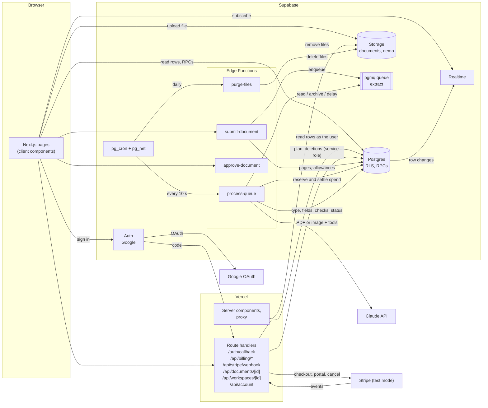
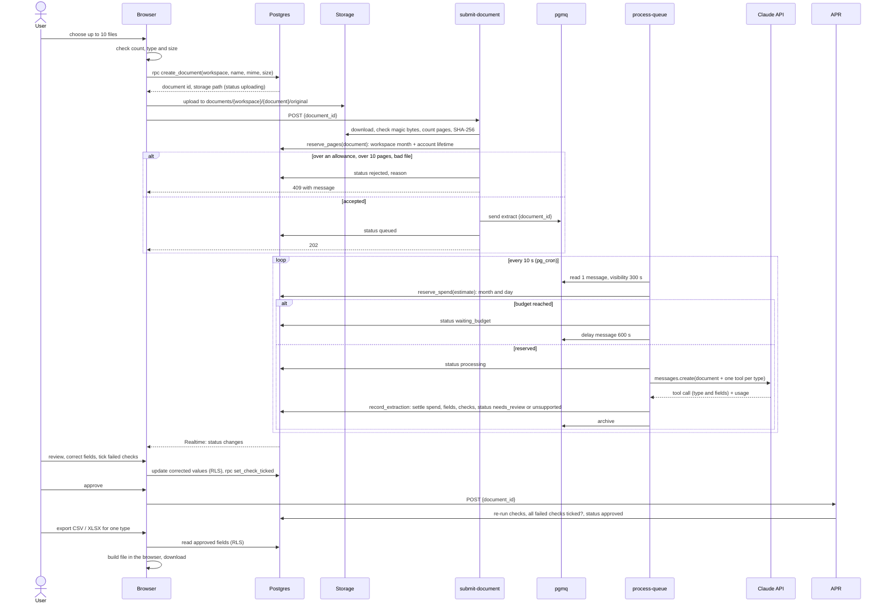
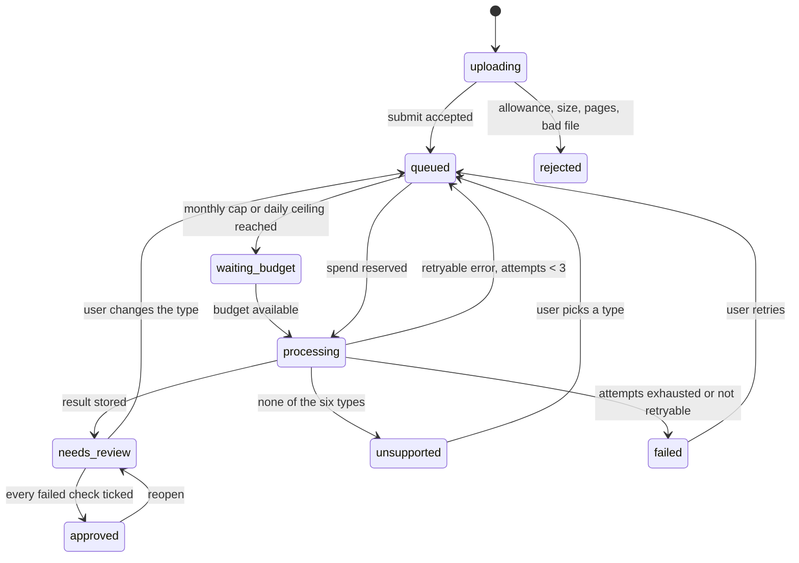

# doc-extract: architecture

Status: for the operator's review (issue #1). Requirements are in [PRD.md](PRD.md); this document
says how they are built. Every open question is answered (PRD.md, "Open questions and answers");
where a design follows from an answer, it names the question (OQ-n).

## 1. Stack

| Layer | Choice |
|---|---|
| Web app | Next.js (App Router), TypeScript, Tailwind, shadcn/ui, on Vercel |
| Server code in the web app | Next.js route handlers on Vercel: Stripe checkout, customer portal and webhook; document, workspace and account deletion; the OAuth callback |
| Backend | Supabase: Postgres with RLS, Auth (Google only), Storage, Realtime, pgmq + pg_cron + pg_net, Edge Functions (Deno) for the extraction pipeline |
| Supabase clients | `@supabase/ssr` with cookie sessions: one browser module, one server module |
| AI | Claude API, called only from the `process-queue` Edge Function |
| Billing | Stripe, test mode only |
| Tests | Vitest (unit and access tests), Playwright (e2e); Claude is mocked everywhere |

**Why the pipeline stays on Supabase.** An extraction (a Claude call on a 10-page PDF, with
retries) can outlast a Vercel function's time limit. The queue, the cron job and the function that
calls Claude therefore run in Supabase, next to the data, and the web app never waits on Claude.
Everything else server-side is either Postgres (functions, policies, cron) or a short Next.js route
handler.

## 2. Components and document flow



How one document goes from upload to export:



Document status:



The UI shows `unsupported` as "Not supported" and `waiting_budget` as "Waiting for budget".
`uploading` rows that never get submitted (the browser closed mid-upload) are removed after one
hour by the daily purge job, with their file if any. `rejected` rows are not listed. A member can
delete a document in any listed status (section 6.2); it then leaves the diagram.

## 3. Repository layout

```
src/
  app/                         Next.js App Router
    (public)/                  /, /demo, /demo/[slug], /sign-in, /privacy, /terms
    (app)/                     signed-in pages: documents, review, export, members, billing, settings
    invite/[token]/            accept an invitation (sign-in first)
    auth/callback/route.ts     exchanges Google's code for a session cookie
    api/billing/checkout/route.ts, api/billing/portal/route.ts
    api/stripe/webhook/route.ts
    api/documents/[id]/route.ts    DELETE: delete one document
    api/workspaces/[id]/route.ts   DELETE: delete a workspace
    api/account/route.ts           DELETE: delete the signed-in account
    layout.tsx                 root layout; imports ./globals.css
    globals.css                design tokens (CSS variables on :root), shadcn layout
  proxy.ts                     Next.js 16's proxy (the renamed middleware.ts): refreshes the session
                               cookie; sends signed-out visitors to /sign-in
  lib/supabase/client.ts       the browser client (createBrowserClient); throws if NEXT_PUBLIC_SUPABASE_URL is unset
  lib/supabase/server.ts       the server client (createServerClient + cookies) and the service-role
                               client; `import 'server-only'`; throws if unset
  lib/supabase/proxy.ts        the proxy's session refresh (request and response cookies); throws if unset
  instrumentation.ts           at server start, throws when STRIPE_SECRET_KEY is set and not sk_test_
  lib/stripe.ts                the only Stripe client, server-only; throws unless the key starts with sk_test_
  lib/stripe-key.ts            the one check of a key's value, used by both of the above
  lib/billing/                 checkout, portal and webhook logic behind the route handlers; the plan shown on the page
  features/…                   upload, documents, review, export, billing, workspace, demo
shared/doctypes/               one module per type (invoice, receipt, bank-statement, purchase-order,
                               delivery-note, quote): field set, record_<type> tool and its JSON
                               Schema, checks, U1 key; checks.ts (shared check kinds, dates),
                               duplicate.ts (U1), currency.ts (OQ-16), index.ts (the registry and
                               prepareResult), review.ts (the checks again on corrected values, for
                               the review screen and approve-document); no imports outside shared/
shared/limits.ts               accepted MIME types, 10 MB (PDF), 7.5 MB (image), 10 pages, 10 files per upload
supabase/
  config.toml
  migrations/                  forward-only SQL
  seed.sql                     local and CI data; no demo rows, which arrive by migration (section 10)
  functions/
    _shared/                   Claude client, env, errors, fixtures
    submit-document/ process-queue/ approve-document/ purge-files/
demo/                          the demo's samples: samples/ (the committed files), samples.ts (their
                               values), make-samples.ts (the generator), upload.ts (to the local bucket)
tests/access/                  Vitest access tests against the local stack
e2e/                           Playwright specs; mock Claude server
eval/                          the eval set and runner (eval/README.md): values.ts (what each document
                               prints), make-documents.ts (the generator, `npm run eval:documents`),
                               documents/ (30 committed files), expected/ (one result each), score.ts,
                               run.ts (`npm run eval -- --model <model>`, `--dry-run`), prices.ts,
                               results/ (one committed file per run)
```

`shared/` is plain TypeScript with no dependencies, so the Next.js app and the Deno functions
import the same definitions (Next.js through a `tsconfig` path alias, Deno by relative import, which
the function bundler follows). Files in it import each other with explicit `.ts` extensions, which
Deno needs. The scaffold milestone proves both builds can import it.

**Where code runs.** Pages are server components by default and read data with the server client,
as the signed-in user, through RLS. The document list and the review screen are client components
because the list subscribes to Realtime and the review screen edits fields; they use the browser
client. The review screen (`src/app/(app)/documents/[id]/`) is first read by its server component
(`src/lib/documents/load-review.ts`), then reads again after each approval, reopen or refused
change; it does not subscribe to Realtime, and a change another member made meanwhile is caught by
the RPCs' status checks and `approve_document`'s comparison of the values. Nothing that holds
a secret is imported by a client component: every module that reads a server-only variable starts
with `import 'server-only'`, so such an import fails the build.

## 4. Database schema

All tables are in `public`, have RLS enabled, and start with `revoke all … from anon,
authenticated`; each grant below is explicit. No policy is open to every row: a table that clients
read in full is read through a function instead (see `plan_limits`). Timestamps are `timestamptz`,
ids are `uuid` with `gen_random_uuid()`. A column that references `profiles` for audit (who uploaded,
approved, corrected, ticked, invited) is `on delete set null`, so deleting an account (F18) keeps
the work it did in workspaces that remain.

### 4.1 Database functions

**Rule for every function**, here and in every later milestone. Its migration and its row in the
table below state all three:

1. **Security**: `security invoker`, unless the function must bypass RLS to do its job; then
   `security definer`, owned by `postgres`, and it checks the caller itself (`auth.uid()`,
   `is_member`, `is_owner`, the invite) before it reads or writes anything.
2. **Search path**: `set search_path = ''`, with every name in the body schema-qualified
   (`public.documents`, `auth.uid()`, `extensions.gen_random_bytes()`).
3. **Grants**: `revoke execute on function … from public, anon, authenticated, service_role`, then
   `grant execute … to` exactly the roles in its row: `authenticated` for a client RPC, `anon` as
   well only when it must be called signed out, `service_role` for a server-only function, and none
   for a trigger function. Supabase's default privileges grant execute on new functions to `anon`,
   `authenticated` and `service_role` by name, so revoking from `public` alone would leave those
   grants in place.

A function not in this table is added to it, by the same rule, in the milestone that creates it.

| Function | Called by | Security | Search path | Grants | Why this security mode |
|---|---|---|---|---|---|
| `is_member(ws uuid) → boolean`, `stable`: the caller has a row in `workspace_members` | RLS and Storage policies, RPCs, route handlers | definer | `set search_path = ''` | revoke execute from public; grant execute to `authenticated` | reads `workspace_members` without recursing into that table's own policy |
| `is_owner(ws uuid) → boolean`, `stable`: that row has role `owner` | RLS policies, RPCs, route handlers | definer | `set search_path = ''` | revoke execute from public; grant execute to `authenticated` | as `is_member` |
| `create_workspace(name text) → uuid` | browser | definer | `set search_path = ''` | revoke execute from public; grant execute to `authenticated` | inserts into `workspaces` and `workspace_members`, which clients cannot insert into |
| `create_invite(ws uuid, email text, role text) → text` | browser | definer | `set search_path = ''` | revoke execute from public; grant execute to `authenticated` | checks `is_owner`; stores the SHA-256 of a random 32-byte token with `expires_at = now() + 7 days` (OQ-18) in `workspace_invites`, which clients cannot insert into; returns the token once, for the copy-link (OQ-19) |
| `accept_invite(token text) → uuid` | browser | definer | `set search_path = ''` | revoke execute from public; grant execute to `authenticated` | reads `workspace_invites`, which the invitee cannot select, and inserts the membership |
| `remove_member(ws uuid, member uuid)` | browser | definer | `set search_path = ''` | revoke execute from public; grant execute to `authenticated` | deletes from `workspace_members`, which has no client delete |
| `set_member_role(ws uuid, member uuid, role text)` | browser | definer | `set search_path = ''` | revoke execute from public; grant execute to `authenticated` | updates `workspace_members`, which has no client update |
| `create_document(ws uuid, file_name text, mime_type text, byte_size bigint) → (id uuid, storage_path text)` | browser | definer | `set search_path = ''` | revoke execute from public; grant execute to `authenticated` | inserts into `documents`, which has no client insert; refuses a MIME type outside OQ-4's list, a size over 10 MB, or a JPEG, PNG or WebP over 7.5 MB (7,500,000 bytes, #28) |
| `get_page_allowance(ws uuid) → (workspace_used int, workspace_limit int, account_used int, account_cap int)`, `stable` | browser | definer | `set search_path = ''` | revoke execute from public; grant execute to `authenticated` | checks `is_member`; reads `plan_limits` and `app_config`, which have no client grants (OQ-2) |
| `add_line_item(document_id uuid, after_position int)` | browser | definer | `set search_path = ''` | revoke execute from public; grant execute to `authenticated` | inserts into `extraction_fields`, which has no client insert (OQ-44); checks `is_member` and status `needs_review`; inserts an empty line of the type's cells (from `line_item_fields`) after line `after_position`, -1 for the first, and moves the later lines down; the cells have no extracted value or confidence, and `corrected_by` names who added them |
| `delete_line_item(document_id uuid, line_position int)` | browser | definer | `set search_path = ''` | revoke execute from public; grant execute to `authenticated` | deletes from `extraction_fields`, which has no client delete (OQ-44); same checks; deletes every cell of line `line_position` (from 0; `position` is a reserved word) and moves the later lines up |
| `set_check_ticked(document_id uuid, check_id text, ticked boolean)` | browser | definer | `set search_path = ''` | revoke execute from public; grant execute to `authenticated` | checks `is_member` and status `needs_review`; writes `check_ticks`, which has no client writes (OQ-11). Any check the document has a `check_results` row for may be ticked, not only a stored fail: the browser re-runs the checks on corrections, and `approve-document` stores the failures it finds |
| `reopen_document(document_id uuid)` | browser | definer | `set search_path = ''` | revoke execute from public; grant execute to `authenticated` | checks `is_member` and status `approved`; sets `needs_review`, clears `approved_by` and `approved_at`, and writes a `reopened` event, neither of which clients may do (OQ-12); ticks are kept |
| `change_document_type(document_id uuid, doc_type text)` | browser | definer | `set search_path = ''` | revoke execute from public; grant execute to `authenticated` | checks `is_member`, status `needs_review` or `unsupported`, that the file is not deleted and that the type is one of the six; deletes the document's fields, check results and ticks, sets `doc_type` and `doc_type_source = 'user'`, clears `duplicate_key` and `duplicate_of` (Lead ruling 1 on #32: `record_extraction` computes them again; later documents pointing at it are not changed), writes a `type_changed` event, reserves pages for an `unsupported` document only (refused like `retry_document` when they no longer fit), resets `attempts` and sends it to the queue (OQ-1) |
| `get_amount_tolerance() → numeric`, `stable` | browser, signed in | definer | `set search_path = ''` | revoke execute from public; grant execute to `authenticated` | reads `app_config.amount_tolerance`, which has no client grants, so the review screen's live re-check uses the server's tolerance (OQ-7) |
| `approve_document(document_id uuid, actor uuid, result jsonb) → jsonb` | `approve-document` (service role) | invoker | `set search_path = ''` | revoke execute from public; grant execute to `service_role` | as `reserve_pages`; section 6.1. Under the workspace's duplicate lock (as `record_extraction`) and the document's row lock: refuses when the values `approve-document` checked are no longer the stored ones; runs U1 against the database with the corrected key and stores `duplicate_key` and `duplicate_of` (Lead ruling 2 on #32); upserts the checks and the fields' flags; approves unless a stored fail has no tick |
| `line_item_fields(doc_type text) → table (name text, kind text, ord int)`, `immutable` | `add_line_item` (as its owner) | invoker | `set search_path = ''` | revoke execute from public; no grant | each type's line-item cells, as `lineFields` in `shared/doctypes/`; an access test compares the two |
| `line_item_count(document_id uuid) → int`, `shift_line_items(document_id uuid, after int, delta int)`, `lock_document_for_review(document_id uuid, statuses text[], refusal text) → documents` | the review RPCs (as their owner) | invoker | `set search_path = ''` | revoke execute from public; no grant | helpers: the number of lines, moving lines by one (through a temporary prefix, since paths are unique), and the review RPCs' shared membership and status check under a row lock |
| `retry_document(document_id uuid)` | browser | definer | `set search_path = ''` | revoke execute from public; grant execute to `authenticated` | checks `is_member`, status `failed` and that the file is not deleted; resets `attempts`, reserves pages and sends to the queue, none of which clients may do (OQ-10) |
| `get_budget_status() → (spent_usd numeric, cap_usd numeric, daily_reached boolean, monthly_reached boolean, resumes_at timestamptz)` | browser, signed in | definer | `set search_path = ''` | revoke execute from public; grant execute to `authenticated` | reads `ai_spend_periods`, `ai_spend_days` and `app_config`, which have no client grants; signed-in users only (OQ-22) |
| `get_plan_limits() → table (plan text, pages_per_period int, monthly_price_usd numeric)`, `stable` | browser and server components, signed in or not | definer | `set search_path = ''` | revoke execute from public; grant execute to `anon`, `authenticated` | reads `plan_limits`, which has RLS and no select policy; `anon` because the landing page shows the plans to visitors who are not signed in (OQ-27) |
| `reserve_pages(document_id uuid) → boolean` | `submit-document` (service role), `retry_document`, `change_document_type` | invoker | `set search_path = ''` | revoke execute from public; grant execute to `service_role` | `service_role` bypasses RLS, so definer is not needed |
| `account_page_cap() → int`, `stable`: the account lifetime cap, `app_config.account_page_cap` (10, OQ-2); null turns the account cap off | `reserve_pages` (as the service role), `get_page_allowance` (as its owner) | invoker | `set search_path = ''` | revoke execute from public; grant execute to `service_role` | its callers may read `app_config` (the service role and `postgres`); it held the constant 10 until milestone 5 added `app_config` and gave it a read of that column |
| `release_pages(document_id uuid)` | `process-queue` (through `record_extraction`), `submit-document` (service role), `delete_document` | invoker | `set search_path = ''` | revoke execute from public; grant execute to `service_role` | as `reserve_pages`; subtracts from the `page_usage` row of the month the pages were counted against (`documents.pages_period_start`), never from the current one |
| `reserve_spend(document_id uuid, estimate numeric) → (reservation uuid, refused_by text)` | `process-queue` (service role) | invoker | `set search_path = ''` | revoke execute from public; grant execute to `service_role` | as `reserve_pages`; decides with `app_config.spend_cap_usd` and `daily_cap_usd` on every call (section 7) |
| `settle_spend(reservation uuid, actual_cost numeric)` | `process-queue` (service role) | invoker | `set search_path = ''` | revoke execute from public; grant execute to `service_role` | as `reserve_pages` |
| `release_stale_spend_reservations() → int` | `purge-files` (service role) | invoker | `set search_path = ''` | revoke execute from public; grant execute to `service_role` | as `reserve_pages` |
| `record_extraction(document_id uuid, reservation uuid, result jsonb) → text` | `process-queue` (service role) | invoker | `set search_path = ''` | revoke execute from public; grant execute to `service_role` | as `reserve_pages`; one attempt in one transaction (section 6.3 step 8). Since milestone 6 it also stores `duplicate_key` and runs the duplicate query (step 7) under a transaction-scoped advisory lock per workspace, taken before the document row, so two documents of a workspace record one after the other (Lead ruling 1 on #27). Earlier means created earlier, then by id (ruling 2); a document counts while it is `queued`, `waiting_budget`, `processing`, `needs_review` or `approved`, file deleted or not, and not while `rejected`, `failed` or `unsupported` (ruling 3 on the worker's questions). It flags the recording document against the earliest earlier match, and every later match in `needs_review` that points to no document or to one created after the recording one; an approved document is left as it is (ruling 2 on the worker's questions). Since milestone 7 a document that reaches `needs_review` also gets an `extracted` event |
| `extract_send(document_id uuid) → bigint` | `submit-document` (service role), `retry_document` (as its owner) | definer | `set search_path = ''` | revoke execute from public; grant execute to `service_role` | sends `{document_id}` to the pgmq queue `extract`; the service role has no grants on `pgmq`, which the API does not expose |
| `extract_read(vt int, qty int) → table (msg_id bigint, read_ct int, enqueued_at timestamptz, message jsonb)` | `process-queue` (service role) | definer | `set search_path = ''` | revoke execute from public; grant execute to `service_role` | as `extract_send`: `pgmq.read` on `extract` only |
| `extract_set_vt(msg_id bigint, vt int)` | `process-queue` (service role) | definer | `set search_path = ''` | revoke execute from public; grant execute to `service_role` | as `extract_send`: `pgmq.set_vt` on `extract` only, to delay a message |
| `extract_archive(msg_id bigint) → boolean` | `process-queue` (service role) | definer | `set search_path = ''` | revoke execute from public; grant execute to `service_role` | as `extract_send`: `pgmq.archive` on `extract` only |
| `delete_document(document_id uuid)` | `DELETE /api/documents/[id]` (service role) | invoker | `set search_path = ''` | revoke execute from public; grant execute to `service_role` | as `reserve_pages`; the route handler checks `is_member` before calling it (section 6.2) |
| `handle_new_user()`, trigger after insert on `auth.users` | Auth, through the trigger | definer | `set search_path = ''` | revoke execute from public; no grant | inserts into `public.profiles`, and creates the personal workspace with the user as owner (OQ-17), as Auth's own role, which has no grant on them |
| `set_correction_audit()`, trigger before update of `corrected_value` on `extraction_fields`, when it changes | the trigger | invoker | `set search_path = ''` | revoke execute from public; no grant | only sets `corrected_by = auth.uid()` and `corrected_at = now()` on the row being updated, and cuts a corrected `card_last4`, `account_number_last4` or `iban_last4` to its last four characters (OQ-29) |

"revoke execute from public" in the table is short for the full revoke in rule 3. When
`retry_document` or `change_document_type` calls `reserve_pages` or `extract_send`, it runs as its
owner, `postgres`, which owns those functions, the tables and the queue, so that call needs no
further grant. The queue is reached only through the four `extract_` functions: the API exposes
`public` and `graphql_public`, never `pgmq_public` (Lead ruling 1 on #24).

Workspace deletion, account deletion and the Stripe webhook are not database functions: they run in
Next.js route handlers with the service-role client (section 6.2), because they also call Stripe
and the Storage API. Document deletion runs in a route handler for the same reason, because it
removes the file through the Storage API; its database part is `delete_document`.

### 4.2 Tables

**profiles**: one row per auth user, created by the trigger `handle_new_user()` on `auth.users`
(section 4.1).

| Column | Type |
|---|---|
| id | uuid PK, references auth.users on delete cascade |
| email | text not null (the Google account's verified address) |
| display_name | text |
| created_at | timestamptz default now() |

RLS: select where `id = auth.uid()` or the row's user shares a workspace with the caller; update
of `display_name` where `id = auth.uid()` (column grant). No insert or delete by clients.

**workspaces**

| Column | Type |
|---|---|
| id | uuid PK |
| name | text not null |
| plan | text not null default 'free', check in ('free','pro') |
| stripe_customer_id | text unique |
| stripe_subscription_id | text |
| plan_period_end | timestamptz |
| plan_cancel_at_period_end | boolean not null default false: the subscription is set to end at `plan_period_end` rather than renew, so the billing page can say when without calling Stripe (milestone 9) |
| created_by | uuid references profiles on delete set null |
| created_at | timestamptz |

RLS: select where `is_member(id)`; update of `name` only where `is_owner(id)` (column grant on
`name`, OQ-17). `plan` and the Stripe columns are written only by the Stripe webhook route handler
with the service role. Creation through `rpc create_workspace(name)` (section 4.1) and, for the
personal workspace, the `handle_new_user()` trigger (OQ-17). No client delete: an owner deletes a
workspace through `DELETE /api/workspaces/[id]` (section 6.2, OQ-30). Every table that holds a
workspace's data references `workspaces` `on delete cascade`, so deleting the row deletes them.

**workspace_members**

| Column | Type |
|---|---|
| workspace_id | uuid references workspaces on delete cascade |
| user_id | uuid references profiles on delete cascade |
| role | text not null check in ('owner','member') |
| created_at | timestamptz |
| | PK (workspace_id, user_id) |

RLS: select where `is_member(workspace_id)`. No direct insert, update or delete: `rpc
accept_invite(token)`, `rpc remove_member(ws, user)` and `rpc set_member_role(ws, user, role)`
(section 4.1) check `is_owner` (or the invite) and refuse to leave a workspace without an owner
(OQ-20).

**workspace_invites**

| Column | Type |
|---|---|
| id | uuid PK |
| workspace_id | uuid references workspaces on delete cascade |
| email | text not null (lower-cased) |
| role | text check in ('owner','member') |
| token_hash | text not null unique (SHA-256 of a random 32-byte token) |
| invited_by | uuid references profiles on delete set null |
| created_at | timestamptz default now() |
| expires_at | timestamptz not null (created_at + 7 days, OQ-18) |
| accepted_at, revoked_at | timestamptz |

RLS: select and update of `revoked_at` where `is_owner(workspace_id)`; the update applies only to
a pending invitation (not accepted, not revoked) and must set `revoked_at`, so a revoked or accepted
one cannot be brought back. Inserted only by `rpc create_invite` (section 4.1). The token is never
stored; the owner copies the link `<site>/invite/<token>` once, when it is created (OQ-19).
`accept_invite` matches `token_hash`, the caller's verified email (`auth.jwt() ->> 'email'`), not
expired, not accepted, not revoked, and refuses a caller who is already a member, so an invitation
never changes an existing role.

**documents**

| Column | Type |
|---|---|
| id | uuid PK |
| workspace_id | uuid references workspaces on delete cascade |
| uploaded_by | uuid references profiles on delete set null |
| doc_type | text check in the six types; null until detected or chosen |
| doc_type_source | text check in ('detected','user'); null until set (OQ-1) |
| status | text check in ('uploading','queued','waiting_budget','processing','needs_review','approved','failed','unsupported','rejected') |
| status_reason | text (user-readable) |
| file_name, mime_type | text |
| byte_size | bigint |
| page_count | int |
| sha256 | text |
| storage_path | text |
| attempts | int default 0 |
| pages_reserved | boolean default false |
| pages_period_start | date: the UTC month `reserve_pages` counted the pages against, which `release_pages` gives them back to (Lead ruling 2 on #24) |
| processing_started_at | timestamptz |
| duplicate_of | uuid references documents on delete set null: the earliest earlier duplicate (OQ-9) |
| duplicate_key | text: the type name and the normalised U1 key fields, joined by `\|`, such as `invoice\|de123456789\|inv1042`; null when any key field is empty or the document is not extracted yet (Lead ruling 1 on #27). Names and numbers are lower cased and lose all whitespace and punctuation; an amount key part is the exact decimal with leading zeros and trailing fractional zeros dropped and the point kept, so 11.80 becomes 11.8 and 1180 stays 1180 (Lead ruling on amount key fields, [issuecomment-6543137847](https://github.com/LucaFastDev/doc-extract/issues/27#issuecomment-6543137847) on #27) |
| created_at, processed_at, approved_at, file_deleted_at | timestamptz |
| approved_by | uuid references profiles on delete set null |

Index on `(workspace_id, created_at desc)`, `(workspace_id, sha256)` and `(workspace_id, duplicate_key)`.

RLS: select where `is_member(workspace_id)`. Insert only through `rpc create_document` (section
4.1; checks `is_member`, sets status `uploading` and the storage path). No client update: type
changes, retries and reopening go through the RPCs in section 4.1, and every other change is made
by Edge Functions with the service role. No client delete: a member deletes a document through
`DELETE /api/documents/[id]` (section 6.2, OQ-20), and every document goes with its workspace
(OQ-30). The tables that hold its results (`extraction_fields`, `check_results`, `check_ticks`,
`document_events`, `extractions`) reference `documents` `on delete cascade`, so deleting the row
deletes them.

**document_events**: the document's history: extractions, approvals, reopens, type changes and
retries (OQ-12, OQ-44).

| Column | Type |
|---|---|
| id | uuid PK |
| document_id | uuid references documents on delete cascade |
| workspace_id | uuid |
| kind | text check in ('extracted','approved','reopened','type_changed','retried') |
| actor | uuid references profiles on delete set null; null for `extracted` |
| created_at | timestamptz default now() |

RLS: select where `is_member(workspace_id)`. Written only by `record_extraction` (`extracted`, each
time a document reaches `needs_review`), `approve_document` (service role) and the RPCs
`reopen_document`, `change_document_type` and `retry_document`. The review screen's history lists
them newest first, with the upload last, which is the document row itself (`created_at`,
`uploaded_by`). Milestone 7's migration gave each document already extracted the `extracted` event
of its last extraction.

**extraction_fields**: one row per field or line-item cell.

| Column | Type |
|---|---|
| id | uuid PK |
| document_id | uuid references documents on delete cascade |
| workspace_id | uuid (copied from the document, for RLS without a join) |
| path | text: `total`, or `line_items[3].amount` |
| kind | text: text, date, amount, number, percent |
| extracted_value | text |
| confidence | numeric(4,3) |
| corrected_value | text |
| corrected_by | uuid references profiles on delete set null |
| corrected_at | timestamptz |
| flags | text[]: low_confidence, check_failed, duplicate, currency_guessed |
| | unique (document_id, path) |

RLS: select where `is_member(workspace_id)`. Update of `corrected_value` only (column grant),
where `is_member(workspace_id)` and the document's status is `needs_review` (policy
`extraction_fields_update`, using and with check); the trigger `set_correction_audit()` sets
`corrected_by` and `corrected_at`. A null `corrected_value` means not corrected: the review screen
stores null when the extracted value is typed again, and an empty string when a field is emptied.
Insert of a new line-item row, and delete of a line item, through `rpc add_line_item` / `rpc
delete_line_item` (section 4.1) with the same conditions (OQ-44); lines stay numbered from 0 with
no gap. Extracted values are never changed by clients. `approve_document` rewrites `flags` from
the checks it stores.

**check_results**

| Column | Type |
|---|---|
| id | uuid PK |
| document_id | uuid references documents on delete cascade |
| workspace_id | uuid |
| check_id | text: `A1`, `D2`, `U1` … |
| status | text check in ('pass','fail','skipped') |
| field_paths | text[] |
| message | text |
| evaluated_at | timestamptz |
| | unique (document_id, check_id) |

RLS: select where `is_member(workspace_id)`. Written only by `process-queue` and
`approve-document`, which upsert by `(document_id, check_id)`. While a user edits, the browser
re-runs the same checks from `shared/doctypes/` (`recheck` in `shared/doctypes/review.ts`, which
`approve-document` runs too) on each saved correction to update checks and flags live (PRD US-4.1
AC-7, OQ-44); the stored rows are the server's result. U1 needs the database, so the browser shows
its stored result until approval (Lead ruling 2 on #32).

**check_ticks**: the user's tick on a failed check (OQ-11).

| Column | Type |
|---|---|
| document_id | uuid references documents on delete cascade |
| workspace_id | uuid |
| check_id | text |
| ticked_by | uuid references profiles on delete set null |
| ticked_at | timestamptz default now() |
| | PK (document_id, check_id) |

RLS: select where `is_member(workspace_id)`. Written only through `rpc set_check_ticked`; deleted
by `change_document_type`. A tick is kept while the check keeps failing after a correction, and is
irrelevant once it passes. `approve-document` refuses when any stored `fail` row has no tick.

**extractions**: one row per Claude call, for cost and debugging.

| Column | Type |
|---|---|
| id | uuid PK |
| document_id | uuid references documents on delete cascade |
| workspace_id | uuid |
| model | text |
| prompt_version | text |
| tool_name | text: `record_invoice` … or `record_not_supported` |
| outcome | text check in ('ok','unsupported','retryable_error','fatal_error','invalid_output') |
| error | text |
| raw_output | jsonb |
| input_tokens, output_tokens | int |
| cost_usd | numeric(10,6) |
| created_at | timestamptz |

RLS: enabled, no client grants. Service role only.

**page_usage**: pages per workspace per calendar month (OQ-2, OQ-3).

| Column | Type |
|---|---|
| workspace_id | uuid references workspaces on delete cascade |
| period_start | date (first day of the UTC month) |
| pages_used | int not null default 0 |
| | PK (workspace_id, period_start) |

**account_page_usage**: pages per account for its lifetime (OQ-2).

| Column | Type |
|---|---|
| user_id | uuid PK references profiles on delete cascade |
| pages_used | int not null default 0 |

RLS on both: select where `is_member(workspace_id)` and where `user_id = auth.uid()` respectively.
Written only by `reserve_pages` / `release_pages`. The UI reads the limits through `rpc
get_page_allowance`.

**plan_limits**: configuration.

| Column | Type |
|---|---|
| plan | text PK ('free','pro') |
| pages_per_period | int |
| monthly_price_usd | numeric(6,2) |

Seeded by migration with (free, 20, 0) and (pro, 500, 19.00) (OQ-24). RLS: enabled, no policies and
no client grants (the `revoke all` baseline). Clients read the limits only through `rpc
get_plan_limits()` (section 4.1), granted to `anon` and `authenticated` (OQ-27). The Stripe price
in `STRIPE_PRICE_PRO` must match `monthly_price_usd` (go-live).

**ai_spend_periods** (one row per UTC month) and **ai_spend_days** (one row per UTC day, OQ-33)

| Column | Type |
|---|---|
| period_start (month) / day (day) | date PK |
| cap_usd | numeric(10,2) not null |
| spent_usd | numeric(10,6) default 0 |
| reserved_usd | numeric(10,6) default 0 |

**ai_spend_reservations**

| Column | Type |
|---|---|
| id | uuid PK |
| document_id | uuid references documents on delete set null |
| period_start, day | date |
| estimate_usd | numeric(10,6) |
| created_at, settled_at | timestamptz |

**app_config**: single-row configuration (`id boolean PK default true check (id)`):
`spend_cap_usd` (10.00), `daily_cap_usd` (2.00, OQ-33), `account_page_cap` (10, OQ-2; null turns
the cap off), `model` (`claude-sonnet-5-5`), `input_usd_per_mtok` (2) and `output_usd_per_mtok`
(10), Sonnet 5.5's prices on Anthropic's pricing page as read on 2026-10-31,
`base_input_tokens` (4000), `max_input_tokens_per_page` (5000), `max_output_tokens` (8192),
`confidence_threshold` (0.80, OQ-8), `amount_tolerance` (0.01, OQ-7), and
`extract_concurrency int not null default 1` (Lead ruling 3 on #24): how many `process-queue`
requests the cron job sends each run, read on every run; 0 sends none; production sets 2
(go-live). The migration inserts the row with these values; the local seed keeps them, so tests
cover the account cap and the daily ceiling.

RLS on the spend tables and `app_config`: enabled, no client grants. Signed-in clients learn the
budget only through `rpc get_budget_status()` (section 4.1).

**stripe_events**: webhook idempotency.

| Column | Type |
|---|---|
| id | text PK (Stripe event id) |
| type | text |
| received_at | timestamptz not null default now() |
| processed_at | timestamptz |

An event counts as a duplicate only when its row has `processed_at` set; a row without it is an event
whose processing failed, which is processed when Stripe sends it again (section 6.2, Lead ruling 3 on
#50). RLS: enabled, no policy and no client grants; only the webhook's service-role client uses it.

**demo_documents**

| Column | Type |
|---|---|
| id | uuid PK |
| slug | text not null unique, lower-case words joined by `-` |
| doc_type | text not null, one of the six types |
| title | text not null |
| summary | text not null: what the sample shows, one line on `/demo`, such as "a failed total check" |
| file_path | text not null unique (object in the `demo` bucket, `{slug}.{ext}`; also the file name the demo shows and exports) |
| page_count | int not null, 1 to 10 |
| result | jsonb not null: `doc_type` (the detected type), `amount_tolerance` (the tolerance its checks ran with), `fields` (`path`, `kind`, `extracted_value`, `confidence`, `flags` as `extraction_fields` stores them; the line items are the `line_items[i].…` paths and the currency is the `currency` field) and `checks` (`check_id`, `status`, `field_paths`, `message` as `check_results` stores them) |
| sort_order | int not null |
| published | boolean not null default false |

RLS: select for `anon` and `authenticated` using `(published)`; no client writes (milestone 11's
migration revokes all and grants select only). The rows arrive by that migration everywhere
(section 10).

### 4.3 Realtime

`documents` is in the `supabase_realtime` publication. The browser subscribes to `postgres_changes`
on `documents` filtered by `workspace_id=eq.<current>`; Realtime applies the table's select policy,
so a client receives only rows it can read (PRD US-10.1 AC-3, covered by an access test and an e2e
test). The browser client passes the session from its cookie to Realtime, so the subscription runs
as the signed-in user.

### 4.4 Access tests

`tests/access/` holds a Vitest file per table, run by `npm run test:access` (its own Vitest config)
against the local stack, in CI after `supabase db reset`. Each signs in, through `supabase-js` with
the anon key, as `anon`, as a member of workspace A and as a member of workspace B, and checks what
each can select, insert, update and delete, including the RPCs and the server-only functions being
refused to clients. For every function in section 4.1 they also check, through a direct connection
to the local database (`SUPABASE_DB_URL`) and `has_function_privilege`, that exactly the roles in
its row can execute it.

**Signing in test users.** Tests cannot drive Google's consent screen. The local `config.toml`
therefore enables the email provider with passwords, for tests only: setup creates users with the
admin API (local service role key) and signs them in with a password through the API. The app's UI
has no email form, and production has the email provider disabled (docs/go-live.md). Playwright's
global setup signs in the same way with `@supabase/ssr` in Node and saves the session cookies as
its storage state.

## 5. Storage

| Bucket | Public | Path | Policies on `storage.objects` |
|---|---|---|---|
| `documents` | no | `{workspace_id}/{document_id}/original` | insert: `authenticated`, where `is_member` of the first path segment and a `documents` row with that id, status `uploading` and that path exists; select: `authenticated`, where `is_member` of the first segment; no update; no client delete |
| `demo` | no | `{slug}.{ext}` | select: `anon` and `authenticated`, where `bucket_id = 'demo'` and a published `demo_documents` row has that object's name as its `file_path`; no client writes |

The `documents` bucket sets `file_size_limit` to 10 MB and `allowed_mime_types` to
`application/pdf`, `image/jpeg`, `image/png` and `image/webp` (OQ-4). The 10 MB is the PDF limit;
a bucket has one size limit for every type, so the 7.5 MB image limit is held by `create_document`
and `submit-document` instead (#28). The `demo` bucket has the same size limit and MIME types. The
review screen shows a file through a signed URL valid for 10 minutes, made in the browser as the
member; the demo's review screen makes it the same way as `anon`. An image is shown as is; every page of a PDF is drawn on a canvas by pdf.js
(`pdfjs-dist`, milestone 7), which runs on the main thread: a document has at most 10 pages, and
no worker file needs to be served. Zoom scales the pages inside a frame that scrolls. The `demo` bucket is
not public, because a public bucket serves every object by URL whatever the policies say, including
the files of unpublished samples. Objects are deleted only through the Storage API with the service
role: by `purge-files` (section 8) and by the deletion route handlers (section 6.2).

## 6. Server code

### 6.1 Edge Functions

| Function | Caller | Auth | Does |
|---|---|---|---|
| `submit-document` | browser | user JWT | Checks membership and status `uploading`; downloads the object; checks magic bytes match the MIME type; refuses an image whose object is over 7.5 MB (7,500,000 bytes, #28); counts pages (PDF via pdf-lib; image = 1, OQ-2) and refuses more than 10 (OQ-4); computes SHA-256; `reserve_pages(document)` (atomic; refuses over the workspace's monthly allowance or the account's lifetime cap); sets status `queued`; `extract_send(document)`, which sends `{document_id}` to the queue `extract`. A refusal sets status `rejected` with the reason and returns 409. If setting `queued` or the send fails, it calls `release_pages`, sets status `rejected` ("could not be queued") and returns 500, so no document holds pages without a message (Lead ruling on #20). It does not check the spend cap: work at the cap waits (OQ-23). |
| `process-queue` | pg_cron via pg_net | shared secret header `x-cron-secret`, checked against `CRON_SECRET`; JWT verification off | Reads one message (`extract_read(vt => 300, qty => 1)`), extracts it (6.3), archives it or delays it. Answers 401 without the right header. |
| `approve-document` | browser | user JWT | Reads the document and its fields as the caller, so a non-member gets 404; checks status `needs_review` (else 409); re-runs the type's checks on the corrected values (`recheck`, `shared/doctypes/review.ts`) with `app_config.amount_tolerance` and today's UTC date, and passes them, the values it checked and the flags to `approve_document` (service role), which in one transaction refuses if a value changed meanwhile (409, "try again"), re-runs U1 against the database with the corrected key fields and updates `duplicate_key` and `duplicate_of` (Lead ruling 2 on #32), upserts the check results and the fields' flags (low confidence as extracted, `check_failed`, `duplicate`, `currency_guessed`), and refuses with 409, naming them, while any stored fail, a newly failing U1 among them, has no tick (OQ-11); otherwise sets `approved`, `approved_by`, `approved_at` and writes an `approved` event. A refusal keeps the stored checks, so the screen shows a new failure with its tick box. |
| `purge-files` | pg_cron via pg_net | shared secret header | Section 8. |

Every function reads its settings through `_shared/env.ts`, which throws at startup when a required
variable is unset; nothing has a default that points at a real service. Stripe is not used by any
Edge Function.

### 6.2 Next.js route handlers and proxy

All run on the Node.js runtime and are short; none calls Claude.

| Route | Caller | Auth | Does |
|---|---|---|---|
| `GET /auth/callback` | Google, through Supabase Auth | OAuth code (PKCE) | `exchangeCodeForSession`, which sets the session cookie; redirects to `next` if it is a path on this site, else to the document list (OQ-34). |
| `POST /api/billing/checkout` | browser, with `{ workspaceId }` in the body | session cookie | `src/lib/billing/sessions.ts`. Server client; 401 with no session; checks `is_owner` (OQ-20), 403 otherwise, a body naming no workspace included; 409 to a workspace already on Pro. Creates a Stripe Checkout session in subscription mode for `STRIPE_PRICE_PRO`, with no trial (OQ-24), the workspace id in the metadata of both the session and the subscription, the workspace's `stripe_customer_id` when it has one, and success and cancel URLs from `SITE_URL` back to the billing page, the success URL naming the workspace (Lead rulings 2, 6 and 8 on #50); returns its URL. |
| `POST /api/billing/portal` | browser, with `{ workspaceId }` in the body | session cookie | Same file and the same 401 and 403; 409 to a workspace with no Stripe customer. Creates a customer portal session returning to the billing page; returns its URL (OQ-37). |
| `POST /api/stripe/webhook` | Stripe | Stripe signature, no session | `src/lib/billing/webhook.ts`. Reads the raw body (`request.text()`), verifies it with `Stripe.webhooks.constructEvent` and `STRIPE_WEBHOOK_SECRET`, answering 400 and changing nothing to a missing or wrong signature. With the service-role client: inserts the event into `stripe_events` on first sight; an event whose row has `processed_at` set is acknowledged and skipped; processes it; then sets `processed_at`. A processing failure answers 500 and leaves `processed_at` null, so Stripe's retry processes it (Lead ruling 3 on #50). `checkout.session.completed` reads the workspace from the session's metadata and the period end from the subscription, which it retrieves from Stripe, and sets `pro`, customer, subscription, period end and whether the subscription is set to end. `customer.subscription.updated` reads the workspace from the subscription's metadata, or else by `stripe_customer_id`, and sets the same columns: status `active` or `past_due` means `pro`, any other `free`. `customer.subscription.deleted`, which Stripe sends at the end of a cancelled period, finds the workspace the same way and always sets `free`, clearing the subscription and the period end and keeping the customer (rulings 2 and 4; OQ-24, OQ-37). An event naming no known workspace is logged as an error and answered 200, changing nothing; any other type is acknowledged with 200. |
| `DELETE /api/documents/[id]` | browser, after the user confirms (PRD US-19.1) | session cookie | `src/lib/documents/delete.ts`. A caller with no session gets 401. Reads the document with the server client, as the caller, so RLS returns it only to a member of its workspace; otherwise 404, and nothing changes. Checks `is_member(workspace_id)`; any member, owner or member, may delete any document of the workspace (OQ-20). With the service-role client: unless `file_deleted_at` is set, removes the object at `storage_path` in `documents` through the Storage API (an object already gone counts as removed); then `rpc delete_document(id)`, which in one transaction locks the row `for update`, calls `release_pages` if the status is `queued`, `waiting_budget` or `processing` (pages held, not yet used, PRD US-19.1 AC-5), and deletes the row, which cascades to its fields, check results, ticks, history and extractions. Pages already counted stay in `page_usage` and `account_page_usage`, which are not keyed by document, so they are not refunded (PRD US-19.1 AC-4); spend already recorded in `ai_spend_periods` and `ai_spend_days` stays too, and `ai_spend_reservations.document_id` and a later document's `duplicate_of` become null. If removing the file fails, it stops before deleting the row and returns 500, so it is safe to run again. Returns 204. |
| `DELETE /api/workspaces/[id]` | browser | session cookie | Checks `is_owner`. With the service-role client: cancels an active subscription at once in Stripe; removes every object under `{id}/` in `documents` through the Storage API, in batches of 100; then deletes the `workspaces` row, which cascades. If removing files fails, it stops before deleting the row and returns 500, so it is safe to run again (OQ-17, OQ-30). |
| `DELETE /api/account` | browser | session cookie | Refuses with 409 while the caller is the only owner of a workspace that has other members (OQ-20). Deletes, as above, every workspace where the caller is the only member; then `auth.admin.deleteUser(caller)`, which cascades to `profiles`, memberships and `account_page_usage`, and sets the caller's audit columns elsewhere to null (OQ-30). |

`src/proxy.ts` (Next.js 16 renamed the `middleware.ts` convention to `proxy.ts`, exporting
`proxy`) refreshes the session cookie on each request (the `@supabase/ssr` pattern), and sends a
signed-out visitor who opens a page outside the public list (`/`, `/demo…`, `/sign-in`,
`/privacy`, `/terms`, `/auth/callback`, `/api/stripe/webhook`) to `/sign-in?next=<path>`. It
redirects only `GET` and `HEAD`: a 307 would make the browser repeat a server action's `POST`
against `/sign-in`, which cannot answer it. It passes the requested path and query on to the page
in an `x-request-path` request header, always overwriting any the browser sent, and each server
action and the signed-in layout check the user themselves: one that finds none, because the
session ended while the page was open, redirects to `/sign-in?next=<that path, through
safeNextPath>`.

The current workspace is a `workspace` cookie holding its id, set by the switcher. It is checked
against the user's memberships on every use and falls back to the personal workspace (the first
one joined); it only chooses what to show and is never trusted for access, which RLS decides.

A live Stripe key is refused twice, through one pure function, `stripeKeyProblem` in
`src/lib/stripe-key.ts` (PRD US-11.1 AC-4, Lead ruling 1 on #50). `src/lib/stripe.ts`, the only place
that creates a Stripe client, throws on use when `STRIPE_SECRET_KEY` is unset or does not start with
`sk_test_`; nothing calls Stripe at import, so the build needs no Stripe variable. Separately,
`register()` in `src/instrumentation.ts` throws at server start when the key is set and does not
start with `sk_test_`. Next.js then answers 500 to every request, though `next start`'s process
stays up. An unset key does not stop the server, because the demo and the landing page run without
Stripe. The client pins the API version `stripe@23.1.0` is typed against, `2026-10-28.endive`, which
keeps the period end on the subscription's item.

**The billing page** (`src/app/(app)/billing/`, PRD US-11.1) is read by its server component as the
user. Owners and members see the plan, the pages from `get_page_allowance`, each plan's limits and
price from `get_plan_limits` and the test-mode notice; only an owner gets Upgrade or "Manage or
cancel", and a Pro plan set to end shows the date. A completed Checkout returns to
`/billing?checkout=success&workspace=<workspace id>`. On every return the page takes the marker and
the workspace out with `router.replace('/billing')`, so the router and the history entry drop them
too and a reload, a workspace switch or a rename runs no timer. The server component acts on the
return only when the marker is `checkout=success`, its `workspace` is the current workspace and the
viewer is an owner of it (`checkoutReturn` in `src/lib/billing/plan.ts`). Then the page re-reads the
plan through RLS every 2 seconds for at most 20 seconds, and stops once it is Pro; still Free after
that, it says "Your payment went through. Your plan will update shortly." Every other return, one
that lands on another workspace, a member's, or a bare `?checkout=success`, is the plain page, with
no timer and nothing about a payment or about the workspace that paid. A cancelled Checkout returns
to `/billing`, which runs no timer and shows no message (Lead rulings 6 and 8 on #50).

The router rebuilds the view on in-app Back from its cached page, whose plan can be from before a
webhook, and with no marker. So whenever the view mounts and is not re-reading, it reads the plan and
the pages once in the browser, through RLS, with the same read the re-reads use, and shows what comes
back, whichever way the plan moved. This covers owners and members, with or without a return before
it. That read starts no timer, shows no "Checking your plan…" and no message, and leaves Upgrade
enabled; if Upgrade is pressed before it lands, the route's 409 answers. A failed read is logged and
the page keeps what it shows, with no error message. A return the page acts on that finds the workspace
on Free makes no such read: its re-reads are the only ones. One that finds it already on Pro starts no
re-reads, so it makes this one read (Lead ruling 9 and choice 23 on #50).

`src/lib/supabase/server.ts` throws when `NEXT_PUBLIC_SUPABASE_URL` or
`NEXT_PUBLIC_SUPABASE_ANON_KEY` is unset, and its service-role client (`createServiceRoleClient`,
milestone 7) throws when `SUPABASE_SERVICE_ROLE_KEY` is unset.

### 6.3 Extraction in process-queue

1. Load the document. Go on if its status is `queued` or `waiting_budget`, or `processing` with
   `processing_started_at` more than 10 minutes ago (an earlier run was killed). If it is
   `processing` and not yet that stale, another run may still be at work: delay the message until
   it would be, and stop; archiving it would strand a killed run's document, whose message
   reappears after the 300 s visibility timeout. Otherwise (already done, deleted, or retried by
   hand) archive the message and stop.
2. `reserve_spend(document_id, estimate)` (section 7). If it is refused by the monthly cap or the
   daily ceiling, set status `waiting_budget` with a `status_reason` naming which one and when it
   resets, delay the message with `extract_set_vt(…, 600)`, and stop. No attempt is counted
   (OQ-23).
3. Set status `processing`, `processing_started_at = now()`, `attempts = attempts + 1`.
4. Call Claude (section 9) with the file from Storage, under `tool_choice` `auto` with every tool
   `strict`: with every type's tool and `record_not_supported` when the type is to be detected,
   or with only the chosen type's tool when `doc_type_source` is `user` (OQ-1). Claude must call
   exactly one of them; no tool call, or more than one, is invalid output (Lead ruling 1 on #24:
   Sonnet 5.5 answers forced tool use, `any` or a named tool, with a 400).
5. If Claude called `record_not_supported`: in `record_extraction`, settle spend, store the
   `extractions` row, set status `unsupported`; then `release_pages` (0 pages, OQ-1); archive;
   stop.
6. Validate the tool input against the type's JSON Schema again, in the function.
7. Normalise values (a card, account or IBAN number cut to its last four characters without
   spaces, in the fields and in the stored `raw_output`, OQ-29), run the type's checks against
   today's UTC date (OQ-6), compute flags (`low_confidence`, `check_failed`, and
   `currency_guessed` on `currency` when `currency_as_printed` is empty or only a symbol in
   `AMBIGUOUS_CURRENCY_SYMBOLS`, never for a delivery note, OQ-16), and the U1 key. U1 as the
   function builds it passes, or is skipped when a key field is empty (OQ-43). In the key, names
   and numbers are lower cased and lose all whitespace and punctuation, and an amount part is the
   exact decimal with leading zeros and trailing fractional zeros dropped and the point kept
   (11.80 becomes 11.8, 1180 stays 1180; Lead ruling on amount key fields,
   [issuecomment-6543137847](https://github.com/LucaFastDev/doc-extract/issues/27#issuecomment-6543137847)
   on #27). The duplicate
   query runs in `record_extraction` (step 8), in the same transaction: a document is a
   duplicate when an earlier document of the workspace has the same `sha256`, or the same
   `duplicate_key` (which holds the type). Earlier means created earlier, then by id (Lead ruling
   2 on #27); it counts while `queued`, `waiting_budget`, `processing`, `needs_review` or
   `approved`, whether or not its file was deleted, and not while `rejected`, `failed` or
   `unsupported`, so a retried document counts again once it is back in `queued` (ruling 3 on the
   worker's questions). The earliest such document becomes `duplicate_of`; U1 fails with a message
   naming its file and whether the file or the key matched ("Duplicate of "a.pdf": the same file
   was uploaded before." when both did), and the `duplicate` flag goes on the U1 key fields that
   have a value, so a match by file alone with an empty key fails with no fields (ruling 3). When
   a document records after a later one that matches it, because the later one finished first,
   the later one is flagged the same way and pointed to it, if it is in `needs_review` and points
   to no document or to one created after the recording one; an approved document is left as it
   is (ruling 2 on the worker's questions). The earlier document is never changed. A duplicate and
   a currency guess keep the status `needs_review` (ruling 4).
8. In one transaction (`record_extraction`): `settle_spend` with the actual usage, the
   `extractions` row, the `extraction_fields` and `check_results` rows, `doc_type` and
   `doc_type_source = 'detected'` when it was detected, status `needs_review`. It locks the
   document row first; if a member deleted the document during the call (section 6.2), it only
   settles spend and the message is archived. Every outcome of an attempt, success or failure,
   writes its `extractions` row through `record_extraction`.
9. `extract_archive`.

A document's pages stay reserved from `submit-document` until the extraction succeeds, when they
are counted for good, or fails or is not supported, when `release_pages` gives them back (OQ-10).

### 6.4 Failures and retries

| Failure | Treatment |
|---|---|
| Monthly cap or daily ceiling reached | Not a failure: status `waiting_budget`, message delayed 600 s, no attempt counted (step 2). |
| Claude 429, 500, 529 (overloaded), network error, timeout | Retryable. Settle spend with any usage reported (none if the call failed before a response), record the attempt, set status back to `queued`, do not archive: the message reappears after its 300 s visibility timeout. |
| Output fails schema validation, no tool call, more than one tool call, or an answer cut off at `max_tokens` (invalid output) | Retried once as above; a second invalid output since the last retry by hand is fatal. |
| Claude 400 (for example an unreadable or encrypted PDF), refusal | Fatal at once. |
| Edge Function killed mid-call (wall-clock limit, deploy) | The message reappears after the visibility timeout; step 1 sees status `processing` with a stale `processing_started_at` and continues as a retry. The purge job's sweep releases spend reservations older than 15 minutes. |
| Attempts reach 3 (`documents.attempts`) | Fatal. |

Fatal: status `failed` with a user-readable `status_reason`, `release_pages` (a failure counts 0
pages, OQ-10), archive the message. The user's retry (`rpc retry_document`, section 4.1) resets
`attempts`, reserves the pages again (refused like an upload if they no longer fit), writes a
`retried` event and re-enqueues; it is refused once the file is deleted.

`process-queue` handles one document per call, and a document has at most 10 pages, so a long bank
statement fits in one Edge Function run. The cron job fires every 10 seconds and sends
`app_config.extract_concurrency` requests each time, reading it on every run (1 by default and
locally, 2 in production, Lead ruling 3 on #24), so at most that many documents are processed at
once; pgmq's visibility timeout stops two runs from taking the same message. The job reads the
functions' base URL and `CRON_SECRET` from Vault (section 12).

## 7. Spend cap and page allowances, server-side

Both are enforced in Postgres functions called only with the service role (or by `postgres` from a
definer RPC), inside a transaction that locks the rows with `select … for update`, so concurrent
calls cannot both pass a limit.

**Page allowances** (OQ-2, OQ-3). `reserve_pages(document_id)` reads the document's workspace,
uploader and `page_count`; finds the workspace's `page_usage` row for the current UTC month and the
uploader's `account_page_usage` row (inserting either if missing); reads the plan's
`pages_per_period` and `app_config.account_page_cap` (through `account_page_cap()`; null turns the
account cap off); refuses if either `pages_used + pages` would pass its limit; otherwise adds the
pages to both, sets `pages_reserved` and records the month in `pages_period_start`. Called by
`submit-document` before anything is queued, and by `retry_document` and `change_document_type`.
`release_pages(document_id)` subtracts them from the `page_usage` row of `pages_period_start`,
never the current month's, and from the account's row, when the document fails, is not supported
or cannot be queued, and clears `pages_reserved` (Lead ruling 2 on #24). The client reads what is left
through `get_page_allowance`; it cannot change it. Usage is per calendar month whatever the plan,
so a change of plan does not reset it (PRD US-11.1 AC-7).

**Spend cap and daily ceiling** (OQ-22, OQ-33). Before each Claude call,
`reserve_spend(document_id, estimate)`:

```
estimate = (base_input_tokens + pages × max_input_tokens_per_page) × input_usd_per_mtok / 1e6
         + max_output_tokens × output_usd_per_mtok / 1e6
```

It locks the current UTC month's `ai_spend_periods` row and the current UTC day's `ai_spend_days`
row (inserting either with `cap_usd` from `app_config` if missing). It refuses, returning
`refused_by` `monthly` or `daily` (the monthly cap checked first), if
`spent_usd + reserved_usd + estimate` would pass `app_config.spend_cap_usd` or
`app_config.daily_cap_usd`, which it reads on every call, so a changed cap takes effect on the next
reservation (PRD US-12.1 AC-5); the rows' `cap_usd` records the cap in force when the row was
created and decides nothing (Lead ruling 8 on #24). Otherwise it adds the estimate to
`reserved_usd` on both, inserts an `ai_spend_reservations` row and returns its id. After the call, `settle_spend(reservation, actual_cost)` moves the estimate out of
`reserved_usd` on both rows and adds the actual cost from the response's `usage` to `spent_usd` on
both. Because the reserved amount is an upper bound, both limits hold even with concurrent calls.
`max_output_tokens` is also sent as the call's `max_tokens`, so the output part of the bound is a
limit, not a guess. The input part rests on `base_input_tokens` (system prompt and tool
definitions) and `max_input_tokens_per_page`, set above the largest values the eval measures;
`settle_spend` logs a warning for any call whose actual cost passed its estimate, so a wrong
setting is visible.

The prices in `app_config` are copied from Anthropic's pricing page for the configured model when
the queue milestone is built, and checked in docs/go-live.md. As a second guard, the Anthropic
Console's monthly spend limit for the production key is $10 (go-live), so an error in our own
accounting cannot spend more. The eval (F16) uses the operator's own key and never touches these
tables (OQ-26).

`get_budget_status()` returns this month's `spent_usd` and `cap_usd` for "$x of $10 used this
month", and whether the daily ceiling or the monthly cap is reached, meaning the budget left is
below the estimate for a one-page document, with the time waiting work resumes: the next UTC
midnight, or the first day of the next UTC month (OQ-22, OQ-23).

## 8. 7-day deletion

A pg_cron job (`purge-files`, daily at 03:00 UTC) calls the `purge-files` function through pg_net.
The function:

1. Selects documents with `created_at < now() - interval '7 days'` and `file_deleted_at is null`,
   on every plan (OQ-14), in batches of 100.
2. Removes their objects with the Storage API (`storage.from('documents').remove(paths)`); direct
   deletes from `storage.objects` leave the files behind and are not used.
3. Sets `file_deleted_at` for each object that was removed. One that failed keeps
   `file_deleted_at` null and is retried on the next run. Running daily keeps every file under
   8 days old, the bound in PRD US-14.1 AC-1 (OQ-39).
4. Removes `uploading` rows older than one hour and their objects, and calls
   `release_stale_spend_reservations()` (section 6.4).

Only files are deleted: fields, checks, ticks and history stay until the document, the workspace
or the account is deleted (OQ-14, OQ-20, OQ-30). A document whose file is deleted cannot be
retried or change type. The `demo` bucket is never touched. The function's run is logged in
`cron.job_run_details`, and the function returns how many files it removed and how many failed.

## 9. Calling Claude

- **Model**: `claude-sonnet-5-5` by default. `app_config.model` is the source of truth;
  `CLAUDE_MODEL` is optional in `_shared/env.ts` and, when set, overrides it, for local runs
  only; production never sets it (Lead ruling 4 on #24, go-live). The eval names its model with
  `--model` (`claude-sonnet-5-5` by default).
  The eval (F16) also runs `claude-haiku-5-5`; if Haiku meets the accuracy targets it becomes the
  default, because the $10 cap buys several times more pages with it. The choice and the measured
  numbers are recorded with each eval run.
- **Input**: one Messages API call per document. A PDF is sent as a base64 `document` content
  block; an image as an `image` content block. Checked against Anthropic's documentation on
  2026-10-31: a request may be 128 MB and a PDF 100 pages (600 with a 1M-token context), so a
  10 MB, 10-page PDF fits; an image may be 10 MB **base64-encoded**, about 7.5 MB of file. The
  image upload limit matches it (#28): 7,500,000 bytes, which base64-encode to exactly 10,000,000,
  within the API's limit whether its MB is 10^6 bytes or MiB, so no accepted image is too large
  for the API. PDFs keep the 10 MB upload limit.
- **Type detection and structured output in one call** (OQ-1): each type's JSON Schema in
  `shared/doctypes/<type>.ts` is the input schema of a tool `record_<type>` with `strict: true`,
  and a seventh tool, `record_not_supported`, also strict, takes a short reason. Sonnet 5.5 refuses
  forced tool use (`tool_choice` `any` or a named tool) with a 400, so every request uses
  `tool_choice: { type: "auto" }`, and the system prompt tells Claude to call exactly one of the
  tools sent (Lead ruling 1 on #24). To detect the type, every type's tool and
  `record_not_supported` are sent; the tool Claude calls is the type. When the user has chosen the
  type, only that type's tool is sent, still under `auto`. A response with no tool call, more than
  one, a tool that was not sent, or an answer cut off at `max_tokens` is invalid output (section
  6.4). `buildRequest` in `_shared/claude.ts` is the one place that builds the request. The
  function validates the tool input again before storing it. Every field in a schema is an object
  `{ value: string, confidence: number }`, and an empty `value` means the document does not show the
  field, stored as null: strict tools allow at most 16 nullable or union-typed parameters per
  request, and an invoice alone has over 30 fields. Line items are arrays of such objects, under
  `line_items`, or `transactions` for a bank statement; both are stored as `line_items[i].<field>`.
  Values are strings so amounts keep their exact decimals.
- **Prompt per type**: a system prompt shared by all types (call exactly one tool, read only what
  is printed, never invent, return an empty value for an absent field, give dates as YYYY-MM-DD and amounts as plain decimals,
  keep text as printed and do not translate (OQ-15), report the currency as an ISO 4217 code and as
  printed, and when none is printed give the most likely one from context (OQ-16), give a
  confidence for each value, call `record_not_supported` for anything that is not one of the six
  types) plus each tool's description and field descriptions, which name the type's fields, their
  meaning and the usual labels in several languages. Each prompt has a `prompt_version`, stored on
  every extraction and every eval run.
- **Temperature**: 0.
- **Client**: `_shared/claude.ts` wraps the official TypeScript SDK in an interface
  `ClaudeClient.extract(file, docType | null) → { docType | 'not_supported', result, usage }`,
  with the SDK's own retries off (retries are the queue's, section 6.4).

### How tests mock Claude

- **Unit tests (Vitest)** inject a fake `ClaudeClient` returning fixtures from
  `supabase/functions/_shared/fixtures/`, one or more per type, including `record_not_supported`,
  invalid output and error responses, so detection, retries, validation and checks are tested
  without the network.
- **End-to-end (Playwright) and local development** run the real Edge Functions against a small
  mock HTTP server (`e2e/mock-claude/`), started by Playwright's `webServer` next to `next dev`.
  The functions reach it because `ANTHROPIC_BASE_URL` points at it in the local functions env file.
  It answers the Messages API with recorded tool-call responses chosen by the SHA-256 of the
  uploaded file, and can be told to return 400, 429 or 529 to test failures and retries. It reads
  the same fixture files as the unit tests, refuses with a 400 a request that is not
  `tool_choice` `auto` with every tool strict, and lists what it was sent at `GET /requests`.
  `npm run functions:env` writes `supabase/functions/.env` (a dummy key, the mock server at
  `host.docker.internal` on a port derived from the checkout, the local `CRON_SECRET`) before
  `npx supabase start`. The e2e upload specs run with `app_config.extract_concurrency` at 0, so
  their documents stay as uploaded; the extraction specs run after them with it at 1.
- `ANTHROPIC_BASE_URL` and `ANTHROPIC_API_KEY` are both required with no default, so a function
  that is missing them fails at startup instead of reaching the real API. CI sets a dummy key and
  the mock URL, and holds no real key.

## 10. The demo

- Sample files live in the `demo` bucket; their rows, with their stored `result` JSON, live in
  `demo_documents`. There is one sample per type, plus a second invoice that duplicates the first,
  so the samples together show every kind of flag (OQ-38): the first invoice fails A3 (its printed
  total), the second fails U1 against it, the quote fails D2 (valid until before its date), and
  the receipt, a photographed PNG, has two faded fields below the 0.8 confidence threshold.
- A worker makes the samples, fictitious, and writes each stored `result` by hand in the format
  `process-queue` stores, with confidences chosen so a low-confidence flag appears; the PR reviewer
  checks the results against the documents (OQ-25, following OQ-26). The files are committed in
  `demo/samples/`, named `{slug}.{ext}` as their `file_path`, and made by `demo/make-samples.ts`
  (`npm run demo:samples`) from the values in `demo/samples.ts`: PDFs with pdf-lib and the receipt
  as a PNG, the same bytes on every run (Lead ruling 2 on #41). `demo/samples.test.ts` checks that
  the committed files are what the script makes, that each result holds the values its document
  prints, and that its checks and flags are what the shared checks give.
- **Rows by migration, everywhere** (Lead ruling 1 on #41). One migration,
  `20261031193713_demo.sql`, creates `demo_documents`, the `demo` bucket and its policy, and
  inserts the seven rows with `published = true`; it runs locally, in CI and in production alike,
  and `supabase/seed.sql` inserts no demo rows. The files are uploaded separately: locally and in
  CI by the e2e setup (`e2e/setup/demo-files.setup.ts`) with the local service role key, by
  `npm run demo:upload` for `npm run dev`, both through `demo/upload.ts`, which refuses any stack
  but the local one; in production once by the operator (docs/go-live.md).
- `/demo` and `/demo/[slug]` (`src/app/(public)/demo/`) are public routes, for signed-in users
  too. Their server components read `demo_documents` with a server client that has no session
  (`createAnonClient` in `src/lib/supabase/server.ts`), so as `anon` whoever is signed in, and
  render the review screen in demo mode from `result`; an unknown or unpublished slug gets the
  not-found page. The document viewer signs its URL in the browser as `anon` too
  (`createAnonClient` in `src/lib/supabase/client.ts`). No Edge Function and no route handler is
  called, so the demo can never call Claude (an e2e test asserts that no request goes to
  `/functions/v1/` or `/api/` from a demo page, and that the spend tables are unchanged).
- **Demo mode** (Lead ruling 3 on #41) is the milestone 7 review screen with a `demo` prop: the
  document viewer with all pages and zoom, flagged fields first, corrections, check ticks and
  line-item add and delete, all kept in browser memory, so a reload shows the stored result again
  (OQ-25). After each edit the browser re-runs the type's checks with the same pure functions from
  `shared/doctypes/` (`liveReview`), with the tolerance stored in `result.amount_tolerance`, since
  `get_amount_tolerance` is not granted to `anon`; U1 is not re-run and keeps its stored result.
  It shows no delete, approve, reopen, type change or history (F14 AC-3, F19 AC-7).
- **Export in demo** (F13 AC-5, Lead ruling 4 on #41): Export with XLSX or CSV builds the file
  from the sample as currently edited with `src/lib/export/files.ts`, loaded by a dynamic import on
  Download, with milestone 8's columns and rules. `document_id` is the sample's
  `demo_documents.id`, `file_name` its `file_path`, and `approved_at` is empty; the file is named
  `<type>-export-<yyyy-mm-dd>` as in milestone 8.

## 11. Export

Export runs in the browser: it reads the chosen approved documents of one type through RLS and
builds the file locally, so no server code and no extra secret is needed (OQ-13). XLSX has two
sheets, "Documents" and "Line items"; CSV is the same two tables as `documents.csv` and
`line_items.csv` in one zip. The CSV writer is our own small, tested function (RFC 4180).

**The page.** `/documents/export` (`src/app/(app)/documents/export/`), opened by the Export button
on the document list, works in the current workspace. The user picks one of the six types (each
shows how many approved documents it has; a type with none cannot be picked), then the approved
documents of that type, newest approval first, all ticked at first, with Select all and Select
none; then XLSX or CSV, and Download, which is disabled while nothing is ticked.
`src/lib/export/load.ts` reads, with the browser client as the signed-in user, the workspace's
`documents` in status `approved`, and on Download reads the ticked ones again (one reopened,
changed to another type or deleted meanwhile is left out, and the page says how many) and their
`extraction_fields`, a page of 1000 rows at a time (PostgREST's `max_rows`) and 100 document ids
per request. A document whose file was deleted after 7 days is exported like any other: its data
remains (section 8).

**The module.** `src/lib/export/model.ts` turns a document's `extraction_fields` rows into plain
data, `{ id, fileName, approvedAt, fields, lineItems }`: each value is `corrected_value` when it is
not null and `extracted_value` otherwise, so an emptied field is empty; a deleted line has no rows
left and an added one has its own, so the lines are the review screen's, in its order. It builds the
two tables from that data. `src/lib/export/files.ts` writes them: `buildXlsx(input)` and
`buildCsvZip(input)` take `{ docType, documents }` and return the file's bytes. Neither reads
Supabase or imports React, so the demo (milestone 11) calls them with its stored results. The page
loads `files.ts` with a dynamic `import()` when Download is pressed, so the two libraries below are
in a chunk of their own that no other page loads. Files are named `<type>-export-<yyyy-mm-dd>.xlsx`
or `.zip`, the type in kebab case (`bank-statement`) and the date the export was made, in UTC.

**Columns** (Lead ruling 1 on #39). Header cells are the field `name`s from `shared/doctypes/`, in
the type's own order, so an import into another tool is stable. "Documents" (`documents.csv`) has
one row per document: `document_id`, `file_name`, `approved_at`, then every header field of the
type. "Line items" (`line_items.csv`) has one row per line item, a bank statement's per transaction:
`document_id`, `file_name`, `position` (from 1, the order on the review screen), then every
line-item field of the type. Every field of the type has a column, even when all its values are
empty, and the currency is in its own column (`currency`, and `currency_as_printed`).

**Values** (Lead ruling 2 on #39). An amount, number or percent that parses as a plain decimal
(`shared/doctypes/decimal.ts`) is a number exactly as stored: a percent of 19 stays 19. In XLSX it
is a numeric cell; in CSV it is the stored text, never passed through a float. A date that is a
full YYYY-MM-DD calendar date is an XLSX date cell shown as `yyyy-mm-dd`, and in CSV that text.
`approved_at` is a date and time in UTC: an XLSX date-time cell shown as `yyyy-mm-dd hh:mm`, and in
CSV ISO 8601 to the second with a `Z`, such as `2026-10-31T14:05:12Z`. A value that does not parse
as its kind is text, as written. An empty or missing value is an empty cell or an empty CSV field.
CSV files are UTF-8 without a byte order mark, with a header row, RFC 4180 quoting (a field holding
a comma, a double quote, a CR or an LF, or starting or ending with a space or a tab, is quoted, its
quotes doubled) and CRLF line ends.

**Formula safety** (Lead ruling 3 on #39, and the Lead's ruling on the worker's question there).
Values come from documents and are untrusted. In XLSX every text value is a string cell, never a
formula. In CSV every value written as text, in any column, that starts with `=`, `+`, `-`, `@`, a
tab or a carriage return gets a single quote `'` in front, so an amount stored as `=1+1` is
written `'=1+1`. Parsed numbers and full dates are never changed, so `-12.50` stays a number.

**Libraries** (Lead ruling 4 on #39), two runtime dependencies, pinned:

| Package | Version | Publisher | Why |
|---|---|---|---|
| `fflate` | 0.8.3 | 101arrowz (Arjun Barrett) | the zip of the two CSV files (`zipSync`); small, no dependencies, runs in the browser and Node; the specs and unit tests also read the files back with it |
| `write-excel-file` | 4.1.1 | catamphetamine | the XLSX: a writer only, typed cells (string, number, date with a number format), several sheets, frozen header row; its one dependency is `fflate`, so the two share one zip implementation. Its `universal` entry returns a `Blob` in the browser and in Node, so the same module runs on the page and in the unit tests. ExcelJS was not chosen: nine dependencies (`jszip`, `archiver`, `unzipper` among them) for a reader and styling the export does not need. The `xlsx` package on the npm registry is not used (ruling 4) |

## 12. Environment variables and secrets

| Name | Used by | Local value | Production value, where it is set |
|---|---|---|---|
| `NEXT_PUBLIC_SUPABASE_URL` | browser and server modules | `http://127.0.0.1:54321` (from `supabase status`) | the production project URL; Vercel, Production env |
| `NEXT_PUBLIC_SUPABASE_ANON_KEY` | browser and server modules | local anon key | the production anon (publishable) key; Vercel |
| `SUPABASE_SERVICE_ROLE_KEY` | route handlers: Stripe webhook, document, workspace and account deletion (server only) | local service role key | the production service role key; Vercel, Production env, sensitive (secret) |
| `STRIPE_SECRET_KEY` | billing, webhook, workspace and account deletion route handlers, and the check at server start (server only) | a test key (`sk_test_…`) or empty; empty in tests, which fake the client (Lead ruling 7 on #50) | a test key (`sk_test_…`); Vercel, sensitive (secret) |
| `STRIPE_WEBHOOK_SECRET` | webhook route handler (server only) | from `stripe listen`; in e2e the test-only value `playwright.config.ts` gives its dev server, which the specs sign fixture events with | the test-mode endpoint's signing secret; Vercel, sensitive (secret) |
| `STRIPE_PRICE_PRO` | checkout route handler (server only) | a test price id | the test-mode Pro price id ($19 a month); Vercel |
| `SITE_URL` | invitation links `<site>/invite/<token>` (`src/lib/site.ts`), checkout and portal return URLs (server only) | `http://localhost:<port>`; the e2e config gives its dev server its own address | `https://<project>.vercel.app`; Vercel |
| `ANTHROPIC_API_KEY` | process-queue; the eval runner, from the operator's own shell (`eval/README.md`) | a dummy value | the production key; Supabase function secrets (secret). The eval uses the operator's own key, never this one |
| `ANTHROPIC_BASE_URL` | process-queue (the eval runner ignores it and always calls the real API) | the mock server's URL | `https://api.anthropic.com`; function secrets |
| `CLAUDE_MODEL` | process-queue locally: optional, overrides `app_config.model` when set (the eval takes `--model` instead) | unset, or a model to try | never set: `app_config.model` in the database decides |
| `CRON_SECRET` | process-queue, purge-files (checked) and pg_cron (sent) | any random string | random 32 bytes; function secrets and Supabase Vault (secret) |
| `app_config.extract_concurrency` (a column, not a variable; Lead ruling 3 on #24) | pg_cron job, read on every run | 1 | 2; set with SQL (go-live) |
| Vault `functions_base_url` and `cron_secret` | pg_cron job | `http://kong:8000/functions/v1` and the local secret, from `supabase/seed.sql` | `https://<prod ref>.supabase.co/functions/v1` and the production `CRON_SECRET`; Supabase Vault (go-live) |
| Google OAuth client id and secret | Supabase Auth | `env()` in `config.toml`, from `supabase/.env` | Supabase dashboard → Auth → Providers → Google (secret) |
| `SUPABASE_URL`, `SUPABASE_SERVICE_ROLE_KEY` | all Edge Functions | provided by the local runtime | provided by Supabase |
| `SUPABASE_ANON_KEY` | `submit-document`, to read as the caller through RLS | provided by the local runtime | provided by Supabase |
| `SUPABASE_DB_URL` | access tests only | from `supabase status` | never set |

Only the two `NEXT_PUBLIC_` variables reach the browser; Next.js inlines them at build time. Every
server-only name is read only in modules that import `server-only`, and none has a `NEXT_PUBLIC_`
prefix. The Stripe variables are no longer Edge Function secrets: Stripe runs only in route
handlers.

pg_cron jobs read the functions' base URL and `CRON_SECRET` from Supabase Vault
(`vault.decrypted_secrets`), so neither is written in a migration.

Files: `.env.example` lists every Next.js variable above (the `NEXT_PUBLIC_` ones and the
server-only ones) without values; `supabase/functions/.env.example` lists every function variable
without values. `.env.local` (local stack values only) and `supabase/functions/.env` are
gitignored, and `.worktreeinclude` lists `.env.local` only. Production values live only in Vercel
and Supabase, never in a file in the repo or a worktree. `src/lib/supabase/client.ts` and
`src/lib/supabase/server.ts` throw at load when `NEXT_PUBLIC_SUPABASE_URL` or
`NEXT_PUBLIC_SUPABASE_ANON_KEY` is unset.

## 13. Milestone plan

Each milestone is one issue for one worker. Days are working days for one worker; the total is
about 13.5. A milestone starts when the ones it depends on are merged. Every open question is
answered; the last column names the answers each milestone applies, so its worker reads them in
PRD.md.

| # | Milestone | Days | Depends on | Decisions it applies |
|---|---|---|---|---|
| 1 | Scaffold: agent-ready Next.js repo | 1 | this PR, and the ai-hq change below | OQ-40, OQ-41 |
| 2 | Google sign-in, profiles, personal workspace, workspace switch, create and rename, RLS helpers, proxy | 1 | 1 | OQ-17, OQ-19, OQ-21, OQ-34 |
| 3 | Copy-link invitations and roles | 1 | 2 | OQ-18, OQ-19, OQ-20 |
| 4 | Upload, Storage, `submit-document`, page allowances, document list with live status | 1 | 2 | OQ-2, OQ-3, OQ-4, OQ-5, OQ-27, OQ-35, OQ-42, OQ-45 |
| 5 | Queue, `process-queue`, Claude client with type detection, mock server, spend cap and daily ceiling, waiting for budget, retries (invoice type only) | 1.5 | 4 | OQ-1, OQ-7, OQ-8, OQ-10, OQ-22, OQ-23, OQ-33, OQ-43 |
| 6 | The other five types: field sets, schemas, tools, checks, duplicate detection, currency rule | 1.5 | 5 | OQ-6, OQ-9, OQ-15, OQ-16, OQ-28, OQ-29, OQ-43 |
| 7 | Review screen, corrections, check ticks, approval, reopen, type change, history, single-document delete | 1.5 | 6 | OQ-1, OQ-11, OQ-12, OQ-20, OQ-40, OQ-44 |
| 8 | Export CSV (zip) and XLSX | 0.5 | 7 | OQ-13 |
| 9 | Billing in Stripe test mode, as route handlers | 1 | 2 | OQ-20, OQ-24, OQ-36, OQ-37, OQ-45 |
| 10 | 7-day purge job and budget display in the UI | 0.5 | 5 | OQ-14, OQ-22, OQ-23, OQ-39 |
| 11 | Public demo | 1 | 7 | OQ-25, OQ-38 |
| 12 | Landing page, privacy and terms pages | 0.5 | 11, 13 | OQ-27, OQ-30, OQ-32, OQ-45 |
| 13 | Eval set and accuracy runner | 1 | 6 | OQ-26, OQ-32 |
| 14 | Account and workspace deletion | 0.5 | 3, 9 | OQ-17, OQ-20, OQ-30 |

Total: 13.5 days. Milestone 9 needs only milestone 2, milestone 10 only milestone 5, milestone 13
only milestone 6, and milestone 14 only milestones 3 and 9, so with two workers they run beside the
main line (1 → 2 → 4 → 5 → 6 → 7 → 11 → 12).

### Milestone 1: scaffold

Goal: the repo passes every check of `~/work/ai-hq/scripts/agent-ready.sh`, and CI runs the
checks it cannot. No feature code. Done when `agent-ready.sh` prints `AGENT-READY` and CI is green
on the PR.

**Before it starts (ai-hq, not this repo).** `agent-ready.sh`'s check "backend target from the
environment" looks for `import.meta.env.VITE_SUPABASE_URL` in `src/`, and for `createClient(` and a
`throw` in the same file. A Next.js app with `@supabase/ssr` reads
`process.env.NEXT_PUBLIC_SUPABASE_URL` and calls `createBrowserClient(` / `createServerClient(`, so
the check must also accept that form before this milestone can print `AGENT-READY`. That change is
made in ai-hq; this milestone does not start until it is merged, and does not add the old string to
any file to pass the check.

| agent-ready.sh check | What the scaffold adds |
|---|---|
| `.env.example committed` | `.env.example` at the root with `NEXT_PUBLIC_SUPABASE_URL=`, `NEXT_PUBLIC_SUPABASE_ANON_KEY=` and every server-only name in section 12, no values; `supabase/functions/.env.example` likewise |
| backend target from the environment, failing loudly when unset | `src/lib/supabase/client.ts` and `src/lib/supabase/server.ts`: each reads `process.env.NEXT_PUBLIC_SUPABASE_URL` (and the anon key), `throw`s at load if unset, and builds its client with `@supabase/ssr` in the same file; no Supabase URL literal anywhere in `src/`; a unit test for each throw |
| `.worktreeinclude lists an env file` | `.worktreeinclude` containing the line `.env.local` |
| `supabase db reset in CI` | `supabase init` (`supabase/config.toml`, with Google configured through `env()` and the email provider enabled for tests only, section 4.4), `supabase/migrations/` with a first migration (extensions pgmq, pg_cron, pg_net), and a workflow in `.github/workflows/` that runs `supabase start` and `supabase db reset` |
| `supabase/seed.sql present` | `supabase/seed.sql`, nearly empty |
| `Vitest installed, with a test` | `vitest` in `package.json`, at least one `*.test.ts`; a second Vitest config for `tests/access/` |
| `Playwright installed, with a test` | `@playwright/test` in `package.json`, at least one `*.spec.ts` that loads the home page |
| `CLAUDE.md present` | `CLAUDE.md`: commands, layout, the rules above (Claude mocked, no production URLs, RLS on every table, tokens in `src/app/globals.css`, server-only secrets never `NEXT_PUBLIC_` and only in `server-only` modules, the extraction pipeline stays in Edge Functions) |
| `gitignored: .env.local`, `gitignored: supabase/.branches` | `.gitignore` entries `.env.local`, `.env*.local`, `supabase/.branches`, `supabase/.temp`, `supabase/.env`, `supabase/functions/.env`, `node_modules`, `.next`, `out` (checked with `git check-ignore`) |
| `design tokens in src/app/globals.css` | shadcn/ui set up, CSS variables on `:root` in `src/app/globals.css` (`--background`, `--foreground`, `--primary`, …), imported by `src/app/layout.tsx` and consumed by Tailwind |
| `e2e server port per checkout` | `playwright.config.ts` setting `E2E_PORT` from the hash of `process.cwd()` as in ai-hq's `docs/03-workers.md` ("Tests"), no hardcoded `localhost:<port>`, `reuseExistingServer: true`; its `webServer` runs `npm run dev -- --port ${PORT}`, without `--strictPort`, which is not a `next dev` option |

The scaffold's CI workflow runs typecheck, lint, unit tests, `supabase db reset`, the access tests,
`next build` and the Playwright suite. Vercel builds with its Next.js preset; no `vercel.json` is
needed. It does not add secrets to CI.

### Milestones 2 to 14

2. **Auth and workspaces**: `profiles`, `workspaces`, `workspace_members`, `is_member`,
   `is_owner`, `create_workspace`, `handle_new_user` creating the personal workspace; Google
   sign-in only (Google configured from `config.toml` `env()`), the sign-in page, `/auth/callback`,
   `src/proxy.ts` with the return-to path; workspace switcher, create and rename; access tests for
   every table.
3. **Invitations and roles**: `workspace_invites`, `create_invite` with the copy-link,
   `/invite/[token]` and `accept_invite`, revoke, `remove_member`, `set_member_role`; members page;
   7-day expiry; last-owner rule; access tests.
4. **Upload**: `documents`, `page_usage`, `account_page_usage`, `plan_limits` with its prices,
   `get_plan_limits` (granted to `anon` and `authenticated`), `get_page_allowance`, `documents`
   bucket and policies, `create_document`, `submit-document` (page count, 10-page limit, magic
   bytes, SHA-256, `reserve_pages`), upload UI with up to 10 files, the 7-day notice, document list,
   Realtime subscription.
5. **Queue and extraction**: pgmq queue `extract`, cron job, `process-queue`, `extractions`,
   `extraction_fields`, `check_results`, `document_events`, `ai_spend_periods`, `ai_spend_days`,
   `ai_spend_reservations`, `app_config`, spend functions, `waiting_budget`, `ClaudeClient` with the
   invoice tool and `record_not_supported`, the mock server, retries and failure states,
   `retry_document`, the invoice type end to end.
6. **Document types**: receipts, bank statements, purchase orders, delivery notes and quotes in
   `shared/doctypes/` and as tools; all checks as pure functions with unit tests per check; the
   tolerance rule; duplicate detection; the currency rule and its flag.
7. **Review**: the review screen (document viewer through a signed URL, all pages and zoom, fields
   flagged first, corrections, line-item add and delete, live re-check), `check_ticks` and
   `set_check_ticked`, `approve-document`, `reopen_document`, `change_document_type`, the document
   history, phone layout; single-document delete (`DELETE /api/documents/[id]`, `delete_document`,
   the confirmation on the document list and the review screen, none in demo mode), with tests
   that the row, the object and every result row are gone, that page usage is unchanged, and that a
   non-member is refused.
8. **Export**: CSV writer with tests; zip of the two CSV files; XLSX with two sheets; export UI
   choosing a type, then approved documents of that type.
9. **Billing**: `/api/billing/checkout`, `/api/billing/portal`, `/api/stripe/webhook`,
   `src/lib/stripe.ts` and `src/instrumentation.ts` with the live-key refusal, `stripe_events`;
   billing page with the plan, its limits and price from `get_plan_limits`, pages left and the
   test-mode notice; webhook tested with signed fixture events
   (`stripe.webhooks.generateTestHeaderString`).
10. **Retention and budget display**: `purge-files` and its cron job, stale-row and reservation
    sweep, `get_budget_status`, "$x of $10 used this month" and the waiting notice for signed-in
    users.
11. **Demo**: `demo_documents`, `demo` bucket, the samples, their generator and their
    hand-written results; one migration that creates the table, the bucket and its policy and
    inserts the rows everywhere, with no seed rows (Lead ruling 1 on #41); the files committed and
    uploaded by the e2e setup and `npm run demo:upload` locally, by the operator in production
    (ruling 2); public demo routes; demo mode of the review screen, re-running the checks in the
    browser (ruling 3), with export (ruling 4).
12. **Landing page and legal pages**: `/` with the copy the Lead provides, demo and sign-in
    buttons, plans and limits from `get_plan_limits` as `anon`, accuracy table from the latest
    committed eval results, the 7-day and test-mode notices, links to the repo and the portfolio;
    `/privacy` and `/terms`.
13. **Eval**: `eval/` with 5 fictitious documents per type and their expected results, made by a
    generator from a values file (`npm run eval:documents`), scoring with unit tests, a runner the
    operator starts on their laptop with their own key (`npm run eval -- --model <model>`, run by
    Node with `--experimental-transform-types` because it imports `_shared/claude.ts`; `--dry-run`
    estimates tokens and cost without a call), results written to
    `eval/results/<yyyy-mm-dd>-<model>.json` and committed.
14. **Deletion**: `DELETE /api/workspaces/[id]` and `DELETE /api/account` with their confirmations
    in the UI, Stripe cancellation, Storage removal, the last-owner refusal; tests that every row
    and object of a deleted workspace is gone and that a remaining workspace keeps a deleted
    user's documents.

## 14. Risks

- **Edge Function run time**: a document has at most 10 pages (OQ-4), and `process-queue` handles
  one per call with a capped output size; the visibility-timeout retry bounds the damage of a run
  that is killed.
- **Budget drain by sign-ups**: there is no captcha (OQ-33). Each account can use at most 10 pages,
  and all AI use is held to $2 a day, so a burst of new accounts can make everyone's documents wait
  until the next UTC day, but cannot spend more than $2 a day or $10 a month. Deleting an account
  and signing in again with the same Google account starts a new 10-page lifetime; the daily
  ceiling bounds that too.
- **Email provider enabled locally**: the local `config.toml` enables email sign-in so tests can
  create users (section 4.4). Pushing that config to production would enable it there; go-live
  checks that the email provider is disabled in production.
- **Route handler time on Vercel**: deleting a large workspace removes its files in batches, and
  the handler is safe to run again if it is cut short.
