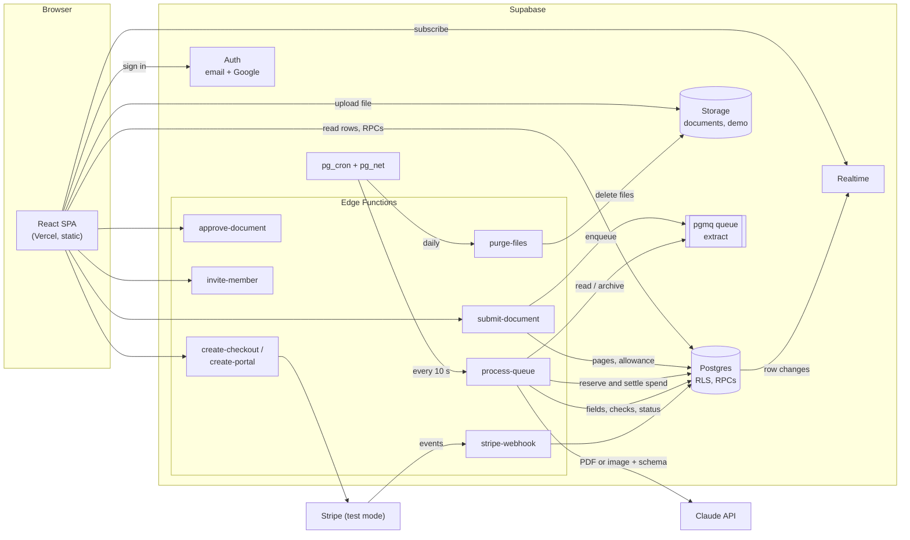
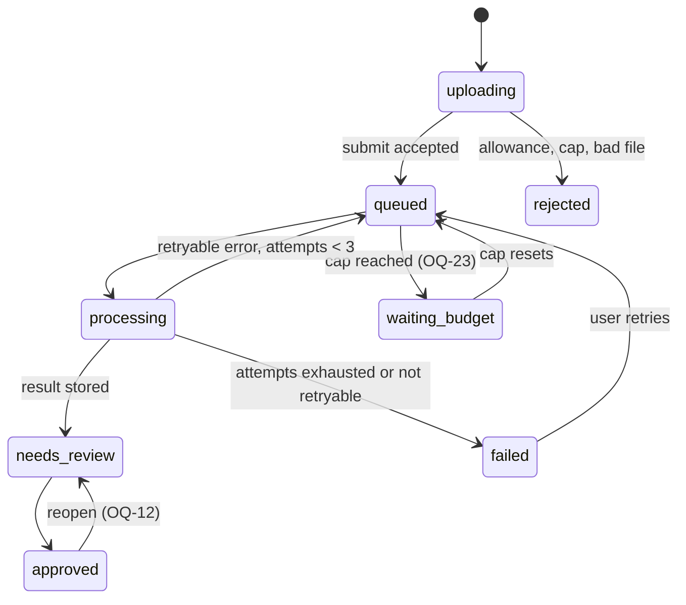

# doc-extract: architecture

Status: draft for the operator's review (issue #1). Requirements are in [PRD.md](PRD.md); this
document says how they are built. Where a design depends on an open question (OQ-n in PRD.md), it
says so, and the worker of that milestone stops until it is answered.

## 1. Stack

| Layer | Choice |
|---|---|
| Frontend | Vite, React, TypeScript, Tailwind, shadcn/ui; a static single-page app on Vercel |
| Backend | Supabase: Postgres with RLS, Auth (email and Google), Storage, Realtime, pgmq + pg_cron + pg_net, Edge Functions (Deno) |
| AI | Claude API, called only from Edge Functions |
| Billing | Stripe, test mode only |
| Tests | Vitest (unit), pgTAP via `supabase test db` (access), Playwright (e2e); Claude is mocked everywhere |

There is no server of our own: everything server-side is Postgres (functions, policies, cron) or
an Edge Function.

## 2. Components and document flow



How one document goes from upload to export:

```mermaid
sequenceDiagram
  actor U as User
  participant SPA
  participant DB as Postgres
  participant ST as Storage
  participant SUB as submit-document
  participant Q as pgmq
  participant PQ as process-queue
  participant C as Claude API

  U->>SPA: choose file(s)
  SPA->>SPA: check type and size
  SPA->>DB: rpc create_document(workspace, name, mime, size)
  DB-->>SPA: document id, storage path (status uploading)
  SPA->>ST: upload to documents/{workspace}/{document}/original
  SPA->>SUB: POST {document_id}
  SUB->>ST: download, check magic bytes, count pages, SHA-256
  SUB->>DB: spend_cap_reached()? reserve_pages(workspace, pages)
  alt over allowance or cap reached
    SUB->>DB: status rejected, reason
    SUB-->>SPA: 409 with message
  else accepted
    SUB->>Q: send extract {document_id}
    SUB->>DB: status queued
    SUB-->>SPA: 202
  end
  loop every 10 s (pg_cron)
    PQ->>Q: read 1 message, visibility 300 s
    PQ->>DB: status processing; reserve_spend(estimate)
    PQ->>C: messages.create(document + per-type schema)
    C-->>PQ: structured result + usage
    PQ->>DB: settle_spend(actual); fields, checks; status needs_review
    PQ->>Q: archive
  end
  DB-->>SPA: Realtime: status changes
  U->>SPA: review, correct fields
  SPA->>DB: update corrected values (RLS)
  U->>SPA: approve
  SPA->>APR: POST {document_id}
  APR->>DB: re-run checks, status approved
  U->>SPA: export CSV / XLSX
  SPA->>DB: read approved fields (RLS)
  SPA->>SPA: build file in the browser, download
```

Document status:



`uploading` rows that never get submitted (the browser closed mid-upload) are removed after one
hour by the daily purge job, with their file if any.

## 3. Repository layout

```
src/                         React app
  lib/supabase.ts            the one Supabase client; throws if VITE_SUPABASE_URL is unset
  index.css                  design tokens (CSS variables on :root), shadcn layout
  features/…                 upload, documents, review, export, billing, workspace, demo
shared/doctypes/             per-type field sets, JSON Schemas, prompts, checks; no imports
supabase/
  config.toml
  migrations/                forward-only SQL
  seed.sql                   local and CI data, including demo rows
  tests/                     pgTAP access tests
  functions/
    _shared/                 Claude client, Stripe client, env, errors
    submit-document/ process-queue/ approve-document/ invite-member/
    create-checkout/ create-portal/ stripe-webhook/ purge-files/
e2e/                         Playwright specs; mock Claude server
eval/                        eval documents, expected results, runner, results
```

`shared/doctypes/` is plain TypeScript with no dependencies, so both the Vite app and the Deno
functions import the same definitions (Vite by path alias, Deno by relative import, which the
function bundler follows). The scaffold milestone proves both builds can import it.

## 4. Database schema

All tables are in `public`, have RLS enabled, and start with `revoke all … from anon,
authenticated`; each grant below is explicit. Timestamps are `timestamptz`, ids are `uuid` with
`gen_random_uuid()`.

### 4.1 Helper functions

All `security definer`, `set search_path = ''`, `stable`, owned by `postgres`, executable by
`authenticated` only:

- `is_member(ws uuid) → boolean`: the caller (`auth.uid()`) has a row in `workspace_members`.
- `is_owner(ws uuid) → boolean`: that row has role `owner`.

They exist so that policies on `workspace_members` do not recurse into themselves.

Server-only functions (`security definer`, `set search_path = ''`, `execute` revoked from
`public`, `anon` and `authenticated`, granted to `service_role`): `reserve_pages`,
`release_pages`, `reserve_spend`, `settle_spend`, `spend_cap_reached`, `record_extraction`.

### 4.2 Tables

**profiles**: one row per auth user, created by a trigger on `auth.users`.

| Column | Type |
|---|---|
| id | uuid PK, references auth.users on delete cascade |
| email | text not null |
| display_name | text |
| created_at | timestamptz default now() |

RLS: select where `id = auth.uid()` or the row's user shares a workspace with the caller; update
of `display_name` where `id = auth.uid()` (column grant). No insert or delete by clients.

**workspaces**

| Column | Type |
|---|---|
| id | uuid PK |
| name | text not null |
| plan | text not null default 'free', check in ('free','pro') |
| stripe_customer_id | text unique |
| stripe_subscription_id | text |
| plan_period_end | timestamptz |
| created_by | uuid references profiles |
| created_at | timestamptz |

RLS: select where `is_member(id)`; update of `name` only where `is_owner(id)` (column grant on
`name`). `plan` and the Stripe columns are written only by `stripe-webhook` with the service role.
Creation through `rpc create_workspace(name)` (security definer: inserts the workspace and the
caller as owner in one transaction; whether it runs automatically at first sign-in is OQ-17). No
client delete (OQ-30).

**workspace_members**

| Column | Type |
|---|---|
| workspace_id | uuid references workspaces on delete cascade |
| user_id | uuid references profiles on delete cascade |
| role | text not null check in ('owner','member') |
| created_at | timestamptz |
| | PK (workspace_id, user_id) |

RLS: select where `is_member(workspace_id)`. No direct insert, update or delete: `rpc
accept_invite(token)`, `rpc remove_member(ws, user)` and `rpc set_member_role(ws, user, role)`
(security definer, `set search_path = ''`) check `is_owner` (or the invite) and refuse to leave a
workspace without an owner.

**workspace_invites**

| Column | Type |
|---|---|
| id | uuid PK |
| workspace_id | uuid references workspaces on delete cascade |
| email | text not null (lower-cased) |
| role | text check in ('owner','member') |
| token_hash | text not null unique (SHA-256 of a random 32-byte token) |
| invited_by | uuid references profiles |
| expires_at | timestamptz not null (OQ-18) |
| accepted_at, revoked_at | timestamptz |

RLS: select and update of `revoked_at` where `is_owner(workspace_id)`. Inserted by `invite-member`
(service role, after checking `is_owner`). `accept_invite` matches `token_hash`, the caller's
verified email, not expired, not accepted, not revoked.

**documents**

| Column | Type |
|---|---|
| id | uuid PK |
| workspace_id | uuid references workspaces |
| uploaded_by | uuid references profiles |
| doc_type | text check in the six types; null until known (OQ-1) |
| status | text check in ('uploading','queued','processing','waiting_budget','needs_review','approved','failed','rejected') |
| status_reason | text (user-readable) |
| file_name, mime_type | text |
| byte_size | bigint |
| page_count | int |
| sha256 | text |
| storage_path | text |
| attempts | int default 0 |
| pages_reserved | boolean default false |
| processing_started_at | timestamptz |
| duplicate_of | uuid references documents |
| created_at, processed_at, approved_at, file_deleted_at | timestamptz |
| approved_by | uuid references profiles |

Index on `(workspace_id, created_at desc)` and `(workspace_id, sha256)`.

RLS: select where `is_member(workspace_id)`. Insert only through `rpc create_document` (checks
`is_member`, sets status `uploading` and the storage path). Clients may update `doc_type` while the
status is `needs_review` (column grant, policy `is_member`; only if OQ-1 lets users change the
type). Every other change is made by Edge Functions with the service role. Delete: OQ-20.

**extraction_fields**: one row per field or line-item cell.

| Column | Type |
|---|---|
| id | uuid PK |
| document_id | uuid references documents on delete cascade |
| workspace_id | uuid (copied from the document, for RLS without a join) |
| path | text: `total`, or `line_items[3].amount` |
| kind | text: text, date, amount, number, percent |
| extracted_value | text |
| confidence | numeric(4,3) |
| corrected_value | text |
| corrected_by | uuid references profiles |
| corrected_at | timestamptz |
| flags | text[]: low_confidence, check_failed, duplicate |
| | unique (document_id, path) |

RLS: select where `is_member(workspace_id)`. Update of `corrected_value` only (column grant),
where `is_member(workspace_id)` and the document's status is `needs_review`; a trigger sets
`corrected_by` and `corrected_at`. Insert of a new line-item row, and delete of a line item, through
`rpc add_line_item` / `rpc delete_line_item` with the same conditions (only if OQ-44 keeps adding
and deleting line items). Extracted values are never
changed by clients.

**check_results**

| Column | Type |
|---|---|
| id | uuid PK |
| document_id | uuid references documents on delete cascade |
| workspace_id | uuid |
| check_id | text: `A1`, `D2`, `U1` … |
| status | text check in ('pass','fail','skipped') |
| field_paths | text[] |
| message | text |
| evaluated_at | timestamptz |

RLS: select where `is_member(workspace_id)`. Written only by `process-queue` and
`approve-document`. While a user edits, the browser re-runs the same checks from
`shared/doctypes/` to update flags live (PRD AC-7 of US-4.1, proposed, OQ-44); the stored rows are
the server's result.

**extractions**: one row per Claude call, for cost and debugging.

| Column | Type |
|---|---|
| id | uuid PK |
| document_id | uuid references documents on delete cascade |
| workspace_id | uuid |
| model | text |
| prompt_version | text |
| outcome | text check in ('ok','retryable_error','fatal_error','invalid_output') |
| error | text |
| raw_output | jsonb |
| input_tokens, output_tokens | int |
| cost_usd | numeric(10,6) |
| created_at | timestamptz |

RLS: enabled, no client grants. Service role only.

**page_usage**

| Column | Type |
|---|---|
| workspace_id | uuid references workspaces |
| period_start | date |
| pages_used | int not null default 0 |
| | PK (workspace_id, period_start) |

RLS: select where `is_member(workspace_id)`. Written only by `reserve_pages` / `release_pages`.
If OQ-2 or OQ-3 makes the 10-page cap per account, a second table `account_page_usage (user_id,
period_start, pages_used)` with select where `user_id = auth.uid()` is added in the same milestone.

**plan_limits**: configuration.

| Column | Type |
|---|---|
| plan | text PK ('free','pro') |
| pages_per_period | int |

Seeded with 20 and 500. RLS: select for `anon` and `authenticated` using `(true)`; no writes by
clients. Plan limits are public on purpose, because the pricing page (part of the landing page
content, OQ-27) reads them before anyone signs in.

**ai_spend_periods**

| Column | Type |
|---|---|
| period_start | date PK |
| cap_usd | numeric(10,2) not null |
| spent_usd | numeric(10,6) default 0 |
| reserved_usd | numeric(10,6) default 0 |

**app_config**: single-row configuration (`id boolean PK default true check (id)`):
`spend_cap_usd` (10.00), `model`, `input_usd_per_mtok`, `output_usd_per_mtok`,
`max_input_tokens_per_page`, `max_output_tokens`, `confidence_threshold` (OQ-8),
`amount_tolerance` (OQ-7).

RLS on both: enabled, no client grants. Clients learn only whether the cap is reached through
`rpc spend_cap_status() → (reached boolean, resumes_on date)`, security definer, granted to
`anon` and `authenticated`.

**stripe_events**: webhook idempotency.

| Column | Type |
|---|---|
| id | text PK (Stripe event id) |
| type | text |
| received_at, processed_at | timestamptz |

RLS: enabled, no client grants.

**demo_documents**

| Column | Type |
|---|---|
| id | uuid PK |
| slug | text unique |
| doc_type | text |
| title | text |
| file_path | text (object in the `demo` bucket) |
| page_count | int |
| result | jsonb: fields, confidences, line items, check results, flags |
| sort_order | int |
| published | boolean default false |

RLS: select for `anon` and `authenticated` using `(published)`; no client writes.

### 4.3 Realtime

`documents` is in the `supabase_realtime` publication. The browser subscribes to `postgres_changes`
on `documents` filtered by `workspace_id=eq.<current>`; Realtime applies the table's select policy,
so a client receives only rows it can read (PRD US-10.1 AC-3, covered by an access test and an e2e
test).

### 4.4 Access tests

`supabase/tests/` holds a pgTAP file per table, run by `supabase test db` in CI. Each checks, as
`anon`, as a member of workspace A and as a member of workspace B: what each can select, insert,
update and delete, including the RPCs and the server-only functions being refused to clients.

## 5. Storage

| Bucket | Public | Path | Policies on `storage.objects` |
|---|---|---|---|
| `documents` | no | `{workspace_id}/{document_id}/original` | insert: `authenticated`, where `is_member` of the first path segment and a `documents` row with that id, status `uploading` and that path exists; select: `authenticated`, where `is_member` of the first segment; no update; no client delete |
| `demo` | read only | `{slug}.{ext}` | select: `anon` and `authenticated` where `bucket_id = 'demo'`; no client writes |

The `documents` bucket sets `file_size_limit` and `allowed_mime_types` from OQ-4. The review screen
shows a file through a signed URL valid for 10 minutes. Deletion is done only by `purge-files`
through the Storage API with the service role (section 8).

## 6. Queue and Edge Functions

### 6.1 Functions

| Function | Caller | Auth | Does |
|---|---|---|---|
| `submit-document` | browser | user JWT | Checks membership and status `uploading`; downloads the object; checks magic bytes match the MIME type; counts pages (PDF via pdf-lib; image = 1, OQ-2); computes SHA-256; refuses if `spend_cap_reached()` (proposed, OQ-23); `reserve_pages` (atomic, refuses over the allowance); sets status `queued`; `pgmq.send('extract', {document_id})`. A refusal sets status `rejected` with the reason and returns 409. |
| `process-queue` | pg_cron via pg_net | shared secret header | Reads one message (`pgmq.read('extract', vt => 300, qty => 1)`), extracts it (6.2), archives it. |
| `approve-document` | browser | user JWT | Re-runs the checks on the corrected values, stores them, applies OQ-11, sets `approved`. |
| `invite-member` | browser | user JWT | Checks `is_owner`, stores the invite, delivers it (OQ-19). |
| `create-checkout` / `create-portal` | browser | user JWT | Checks `is_owner` (OQ-20); creates a Stripe Checkout session for the Pro price or a customer portal session; returns its URL. |
| `stripe-webhook` | Stripe | Stripe signature, no JWT | Verifies the signature (`constructEventAsync`); inserts the event id into `stripe_events` (a duplicate is acknowledged and skipped); on `checkout.session.completed`, `customer.subscription.updated` and `customer.subscription.deleted` sets the workspace's plan and period end. |
| `purge-files` | pg_cron via pg_net | shared secret header | Section 8. |

Every function reads its settings through `_shared/env.ts`, which throws at startup when a required
variable is unset; nothing has a default that points at a real service. `_shared/stripe.ts`
throws if `STRIPE_SECRET_KEY` does not start with `sk_test_` (PRD US-11.1 AC-4).

### 6.2 Extraction in process-queue

1. Load the document. Go on if its status is `queued`, or `processing` with
   `processing_started_at` more than 10 minutes ago (an earlier run was killed); otherwise
   (already done, or retried by hand) archive the message and stop.
2. Set status `processing`, `processing_started_at = now()`, `attempts = attempts + 1`.
3. `reserve_spend(document_id, estimate)` (section 7). If refused, set status `waiting_budget` or
   `failed` (OQ-23), archive, stop.
4. Call Claude (section 9) with the file from Storage.
5. Validate the output against the type's JSON Schema again, in the function.
6. Normalise values, run the type's checks and the duplicate query, compute flags.
7. In one transaction (`record_extraction`): `settle_spend` with the actual usage, the
   `extractions` row, the `extraction_fields` and `check_results` rows, status `needs_review`.
8. `pgmq.archive`.

### 6.3 Failures and retries

| Failure | Treatment |
|---|---|
| Claude 429, 500, 529 (overloaded), network error, timeout | Retryable. Settle spend with any usage reported (none if the call failed before a response), record the attempt, set status back to `queued`, do not archive: the message reappears after its 300 s visibility timeout. |
| Output fails schema validation | Retried once as above; a second invalid output is fatal. |
| Claude 400 (for example an unreadable or encrypted PDF), refusal | Fatal at once. |
| Edge Function killed mid-call (wall-clock limit, deploy) | The message reappears after the visibility timeout; step 1 sees status `processing` with a stale `processing_started_at` and continues as a retry. A sweep in the purge job releases spend reservations older than 15 minutes. |
| Attempts reach 3 (`documents.attempts`) | Fatal. |

Fatal: status `failed` with a user-readable `status_reason`, archive the message, and apply OQ-10
to the reserved pages (`release_pages` or not). The user's retry (`rpc retry_document`, proposed,
OQ-10) resets
`attempts`, reserves pages again if they were released, and re-enqueues.

`process-queue` handles one document per call so a long bank statement fits in one Edge Function
run. The cron job fires every 10 seconds and sends up to `EXTRACT_CONCURRENCY` (default 2)
requests each time, so at most that many documents are processed at once; pgmq's visibility
timeout stops two runs from taking the same message.

## 7. Spend cap and page allowances, server-side

Both are enforced in Postgres functions called only with the service role, inside a transaction
that locks the row with `select … for update`, so concurrent calls cannot both pass a limit.

**Page allowance.** `reserve_pages(workspace_id, pages)`: find the period row (inserting it if
missing), read the plan's `pages_per_period` from `plan_limits` (and, depending on OQ-2, the
account cap), refuse if `pages_used + pages > limit`, otherwise add them. Called by
`submit-document` before anything is queued. `release_pages` reverses it (OQ-10). The client only
reads `page_usage` to show what is left; it cannot change it.

**Spend cap.** Before each Claude call, `reserve_spend(document_id, estimate)`:

```
estimate = pages × max_input_tokens_per_page × input_usd_per_mtok / 1e6
         + max_output_tokens × output_usd_per_mtok / 1e6
```

It refuses if `spent_usd + reserved_usd + estimate > cap_usd` for the current period, otherwise
adds the estimate to `reserved_usd` and returns a reservation id. After the call,
`settle_spend(reservation, actual_cost)` moves the estimate out of `reserved_usd` and adds the
actual cost from the response's `usage` to `spent_usd`. Because the reserved amount is an upper
bound, the cap holds even with concurrent calls. `max_output_tokens` is also sent as the call's
`max_tokens`, so the output part of the bound is a limit, not a guess. The input part rests on
`max_input_tokens_per_page`, set above the largest per-page input the eval measures; `settle_spend`
logs any call whose actual input passed its estimate, so a wrong setting is visible.

The prices in `app_config` are copied from Anthropic's pricing page for the configured model when
the queue milestone is built, and checked in docs/go-live.md. As a second guard, the Anthropic
Console's monthly spend limit for the production key is $10 (go-live), so an error in our own
accounting cannot spend more.

`spend_cap_status()` lets the browser show the paused message before a user uploads.

## 8. 7-day deletion

A pg_cron job (`purge-files`, daily at 03:00 UTC) calls the `purge-files` function through pg_net.
The function:

1. Selects documents with `created_at < now() - interval '7 days'` and `file_deleted_at is null`
   (OQ-14 may change the clock or the scope), in batches of 100.
2. Removes their objects with the Storage API (`storage.from('documents').remove(paths)`); direct
   deletes from `storage.objects` leave the files behind and are not used.
3. Sets `file_deleted_at` for each object that was removed. One that failed keeps
   `file_deleted_at` null and is retried on the next run. Running daily keeps every file under
   8 days old, the bound proposed in PRD US-14.1 AC-1 (OQ-39); a tighter bound needs a more
   frequent schedule.
4. Removes `uploading` rows older than one hour and their objects, and releases stale spend
   reservations (section 6.3).

The `demo` bucket is never touched. The function's run is logged in `cron.job_run_details`, and the
function returns how many files it removed and how many failed.

## 9. Calling Claude

- **Model**: `claude-sonnet-5-5` by default, set in `app_config.model` (and `CLAUDE_MODEL` locally).
  The eval (F16) also runs `claude-haiku-5-5`; if Haiku meets the accuracy targets it becomes the
  default, because the $10 cap buys several times more pages with it. The choice and the measured
  numbers are recorded with each eval run.
- **Input**: one Messages API call per document. A PDF is sent as a base64 `document` content
  block; an image as an `image` content block. The file must be within the API's request size and
  page limits, which the scaffold milestone checks against Anthropic's current documentation and
  writes into OQ-4's limits.
- **Structured output**: each type's JSON Schema in `shared/doctypes/<type>.ts` is passed as the
  response schema, so the response is JSON of that shape (Structured Outputs; forced tool use is
  the fallback if a schema feature is not supported). The function validates the result again
  before storing it. Every field in the schema is an object `{ value: string | null, confidence:
  number }`; line items are arrays of such objects. Values are strings so amounts keep their exact
  decimals.
- **Prompt per type**: a system prompt shared by all types (read only what is printed, never
  invent, return null for an absent field, give dates as YYYY-MM-DD and amounts as plain decimals,
  keep text as printed, report the currency as an ISO 4217 code and as printed, give a confidence
  for each value) plus a per-type section naming its fields, their meaning and the usual labels in
  several languages. Each prompt has a `prompt_version`, stored on every extraction and every eval
  run. Type detection, if OQ-1 chooses it, is a field `doc_type` in a first, shared schema.
- **Temperature**: 0.
- **Client**: `_shared/claude.ts` wraps the official TypeScript SDK in an interface
  `ClaudeClient.extract(file, docType) → { result, usage }`.

### How tests mock Claude

- **Unit tests (Vitest)** inject a fake `ClaudeClient` returning fixtures from
  `supabase/functions/_shared/fixtures/`, one or more per type, including invalid output and error
  responses, so retries, validation and checks are tested without the network.
- **End-to-end (Playwright) and local development** run the real Edge Functions against a small
  mock HTTP server (`e2e/mock-claude/`), started by Playwright's `webServer`. The functions reach it
  because `ANTHROPIC_BASE_URL` points at it in the local functions env file. It answers the Messages
  API with recorded fixture responses chosen by the SHA-256 of the uploaded file, and can be told to
  return 429 or 529 to test retries.
- `ANTHROPIC_BASE_URL` and `ANTHROPIC_API_KEY` are both required with no default, so a function
  that is missing them fails at startup instead of reaching the real API. CI sets a dummy key and
  the mock URL, and holds no real key.

## 10. The demo

- Sample files live in the `demo` bucket; their rows, with their stored `result` JSON, live in
  `demo_documents`.
- Locally and in CI, `supabase/seed.sql` inserts the rows and the e2e setup uploads the files.
  In production they arrive in a data migration (rows) and a one-off upload by the operator
  (files), listed in docs/go-live.md; seed.sql never runs in production.
- `/demo` and `/demo/:slug` are public routes. They read `demo_documents` as `anon` and show the
  review screen in demo mode, from `result`, with no Supabase session. No Edge Function is called,
  so the demo can never call Claude (an e2e test asserts that no request goes to any function
  from a demo page).
- How the stored results are produced, and what a visitor can do with them, are OQ-25. Proposed
  there: demo mode keeps any edits in browser memory only. Which flags the samples must show is
  OQ-38.

## 11. Export

Export runs in the browser: it reads the approved documents' fields through RLS and builds the
file locally, so no Edge Function and no extra secret is needed. CSV is written by our own small,
tested function (RFC 4180). XLSX uses a library chosen and justified in its milestone. The layout
follows OQ-13.

## 12. Environment variables and secrets

| Name | Used by | Local value | Production value, where it is set |
|---|---|---|---|
| `VITE_SUPABASE_URL` | browser | `http://127.0.0.1:54321` (from `supabase status`) | the production project URL; Vercel, Production env |
| `VITE_SUPABASE_ANON_KEY` | browser | local anon key | the production anon (publishable) key; Vercel |
| `ANTHROPIC_API_KEY` | process-queue | a dummy value | the production key; Supabase function secrets (secret) |
| `ANTHROPIC_BASE_URL` | process-queue | the mock server's URL | `https://api.anthropic.com`; function secrets |
| `CLAUDE_MODEL` | process-queue, eval | `claude-sonnet-5-5` | `app_config.model` in the database |
| `STRIPE_SECRET_KEY` | create-checkout, create-portal, stripe-webhook | a test key (`sk_test_…`) or empty, Stripe e2e mocked | a test key (`sk_test_…`); function secrets (secret) |
| `STRIPE_WEBHOOK_SECRET` | stripe-webhook | from `stripe listen` | the test-mode endpoint's signing secret; function secrets (secret) |
| `STRIPE_PRICE_PRO` | create-checkout | a test price id | the test-mode Pro price id; function secrets |
| `SITE_URL` | checkout and portal return URLs, invites | `http://localhost:<port>` | the production domain; function secrets |
| `CRON_SECRET` | process-queue, purge-files (checked) and pg_cron (sent) | any random string | random 32 bytes; function secrets and Supabase Vault (secret) |
| `EXTRACT_CONCURRENCY` | pg_cron job | 1 | 2 |
| Google OAuth client id and secret | Supabase Auth | `env()` in `config.toml`, from `supabase/.env` | Supabase dashboard → Auth → Providers → Google (secret) |
| `SUPABASE_URL`, `SUPABASE_SERVICE_ROLE_KEY` | all functions | provided by the local runtime | provided by Supabase; never in the browser or the repo |

pg_cron jobs read the functions' base URL and `CRON_SECRET` from Supabase Vault
(`vault.decrypted_secrets`), so neither is written in a migration.

Files: `.env.example` lists every `VITE_` variable without values; `supabase/functions/.env.example`
lists every function variable without values. `.env.local` (local stack) and
`supabase/functions/.env` are gitignored, and `.worktreeinclude` lists `.env.local` only, so a
worktree never receives production settings. `src/lib/supabase.ts` throws when
`VITE_SUPABASE_URL` or `VITE_SUPABASE_ANON_KEY` is unset.

## 13. Milestone plan

Each milestone is one issue for one worker. Days are working days for one worker; the total is
about 13. A milestone starts when the ones it depends on are merged and the open questions it names
are answered; a worker who finds one unanswered stops and asks.

| # | Milestone | Days | Depends on | Open questions |
|---|---|---|---|---|
| 1 | Scaffold: agent-ready repo | 1 | this PR | OQ-40, OQ-41 |
| 2 | Auth, profiles, workspaces, RLS helpers | 1 | 1 | OQ-17, OQ-21, OQ-34 |
| 3 | Invitations and roles | 1 | 2 | OQ-18, OQ-19, OQ-20 |
| 4 | Upload, Storage, `submit-document`, page allowance, document list with live status | 1 | 2 | OQ-1, OQ-2, OQ-3, OQ-4, OQ-5, OQ-23, OQ-35, OQ-42, OQ-45 |
| 5 | Queue, `process-queue`, Claude client, mock server, spend cap, retries (invoice type only) | 1.5 | 4 | OQ-7, OQ-8, OQ-10, OQ-22, OQ-23, OQ-43 |
| 6 | The other five types: field sets, schemas, prompts, checks, duplicate detection | 1.5 | 5 | OQ-6, OQ-9, OQ-15, OQ-16, OQ-28, OQ-29, OQ-43 |
| 7 | Review screen, corrections, approval | 1.5 | 6 | OQ-11, OQ-12, OQ-40, OQ-44 |
| 8 | Export CSV and XLSX | 0.5 | 7 | OQ-13 |
| 9 | Billing in Stripe test mode | 1 | 2 | OQ-20, OQ-24, OQ-36, OQ-37, OQ-45 |
| 10 | 7-day purge job and spend cap message in the UI | 0.5 | 5 | OQ-14, OQ-23, OQ-39 |
| 11 | Public demo | 1 | 7 | OQ-25, OQ-38 |
| 12 | Landing page | 0.5 | 11, 13 | OQ-27, OQ-45 |
| 13 | Eval set and accuracy runner | 1 | 6 | OQ-26, OQ-32 |

Total: 13 days. Milestone 9 needs only milestone 2, milestone 10 only milestone 5, and milestone 13
only milestone 6, so with two workers they run beside the main line (1 → 2 → 4 → 5 → 6 → 7 → 11
→ 12).

### Milestone 1: scaffold

Goal: the repo passes every check of `~/work/ai-hq/scripts/agent-ready.sh`, and CI runs the
checks it cannot. No feature code. Done when `agent-ready.sh` prints `AGENT-READY` and CI is green
on the PR.

| agent-ready.sh check | What the scaffold adds |
|---|---|
| `.env.example committed` | `.env.example` at the root with `VITE_SUPABASE_URL=` and `VITE_SUPABASE_ANON_KEY=`, no values; `supabase/functions/.env.example` likewise |
| backend target from the environment, failing loudly when unset | `src/lib/supabase.ts`: reads `import.meta.env.VITE_SUPABASE_URL`, `throw`s if unset, calls `createClient(` in the same file; no Supabase URL literal anywhere in `src/`; a unit test for the throw |
| `.worktreeinclude lists an env file` | `.worktreeinclude` containing the line `.env.local` |
| `supabase db reset in CI` | `supabase init` (`supabase/config.toml`), `supabase/migrations/` with a first migration (extensions pgmq, pg_cron, pg_net), and a workflow in `.github/workflows/` that runs `supabase start` and `supabase db reset` |
| `supabase/seed.sql present` | `supabase/seed.sql`, nearly empty |
| `Vitest installed, with a test` | `vitest` in `package.json`, at least one `*.test.ts` |
| `Playwright installed, with a test` | `@playwright/test` in `package.json`, at least one `*.spec.ts` that loads the home page |
| `CLAUDE.md present` | `CLAUDE.md`: commands, layout, the rules above (Claude mocked, no production URLs, RLS on every table, tokens in `src/index.css`) |
| `gitignored: .env.local`, `gitignored: supabase/.branches` | `.gitignore` entries `.env.local`, `.env*.local`, `supabase/.branches`, `supabase/.temp`, `supabase/functions/.env`, `node_modules`, `dist` (checked with `git check-ignore`) |
| `design tokens in src/index.css` | shadcn/ui set up, CSS variables on `:root` in `src/index.css` (`--background`, `--foreground`, `--primary`, …), consumed by Tailwind |
| `e2e server port per checkout` | `playwright.config.ts` setting `E2E_PORT` from the hash of `process.cwd()` as in ai-hq's `docs/03-workers.md` ("Tests"), no hardcoded `localhost:<port>`, `reuseExistingServer: true` |

The scaffold's CI workflow runs typecheck, lint, unit tests, `supabase db reset`, `supabase test
db` and the Playwright suite; it also adds `vercel.json` with the single-page-app rewrite. It does
not add secrets to CI.

### Milestones 2 to 13

2. **Auth and workspaces**: `profiles`, `workspaces`, `workspace_members`, `is_member`,
   `is_owner`, `create_workspace`; email and Google sign-in (Google configured from `config.toml`
   `env()`); protected routes; access tests for every table.
3. **Invitations and roles**: `workspace_invites`, `invite-member`, `accept_invite`,
   `remove_member`, `set_member_role`; members page; last-owner rule; access tests.
4. **Upload**: `documents`, `page_usage`, `plan_limits`, `documents` bucket and policies,
   `create_document`, `submit-document` (page count, magic bytes, SHA-256, `reserve_pages`),
   upload UI, document list, Realtime subscription.
5. **Queue and extraction**: pgmq queue `extract`, cron job, `process-queue`, `extractions`,
   `extraction_fields`, `check_results`, `ai_spend_periods`, `app_config`, spend functions,
   `ClaudeClient` and the mock server, retries and failure states, the invoice type end to end.
6. **Document types**: receipts, bank statements, purchase orders, delivery notes and quotes in
   `shared/doctypes/`; all checks as pure functions with unit tests per check; duplicate detection.
7. **Review**: the review screen (document viewer through a signed URL, fields flagged first,
   corrections, line-item add and delete, live re-check: OQ-44), `approve-document`, phone layout
   (OQ-40).
8. **Export**: CSV writer with tests; XLSX; export UI on approved documents.
9. **Billing**: `create-checkout`, `create-portal`, `stripe-webhook`, `stripe_events`, billing
   page, test-mode notice, live-key refusal; webhook tested with signed fixture events.
10. **Retention and cap message**: `purge-files` and its cron job, stale-row and reservation
    sweep, `spend_cap_status` and the paused message on upload and retry.
11. **Demo**: `demo_documents`, `demo` bucket, seed rows and sample files, data migration for
    production, public demo routes, demo mode of the review screen.
12. **Landing page**: `/`, demo and sign-up buttons, accuracy table from the latest eval results.
13. **Eval**: `eval/` documents and expected results, scoring with unit tests, a runner the
    operator starts locally with a real key, results written to `eval/results/`.

## 14. Risks

- **Edge Function run time**: a long bank statement may approach the function's wall-clock limit;
  one document per call, a capped output size and the visibility-timeout retry bound the damage.
  If it is still too slow, very long statements are refused with a message (OQ-4's page limit).
- **Budget drain by sign-ups**: see OQ-33. The spend cap protects the operator's money either way;
  without a sign-up limit it can make the app unavailable to everyone for the rest of the month.
- **Email in production**: email sign-in and invitations need an email provider (OQ-19).
